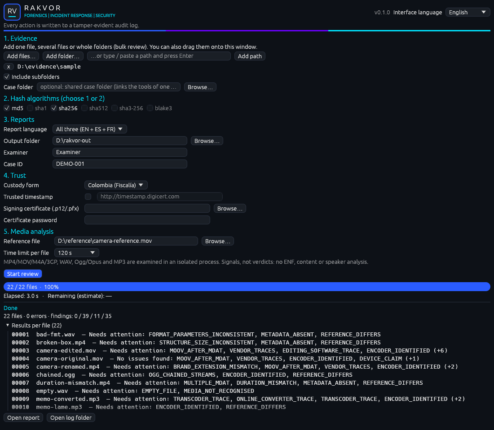
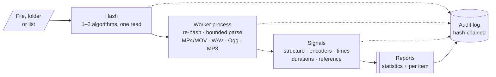
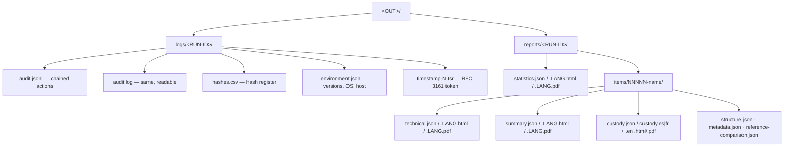

<p align="center"></p>

# RV AvAuth

<!-- forge:description -->
**Audio and video authenticity signals.** Checks container structure (MP4/MOV, OGG/Opus, WAV, MP3) and encoder traces; ENF analysis comes later.
<!-- /forge:description -->

[](https://github.com/Panacota96/rv-avauth/actions/workflows/ci.yml)






## Contents

- [What you get](#what-you-get)
- [Install](#install)
- [Quick start](#quick-start)
- [Outputs](#outputs)
- [Documentation](#documentation)
- [Project layout](#project-layout)
- [Contributing, security, licence](#contributing-security-licence)
- [Licence](#licence)

## What you get

| | |
| --- | --- |
| **Two ways to use it** | `rv-avauth` (command line) and `rv-avauth-gui` (Windows 10/11 desktop app). Same engine, same results. |
| **Containers** | MP4 / MOV / M4A / 3GP (ISO BMFF box tree, brands, mvhd/tkhd/mdhd, hdlr, stsd, udta/meta/ilst/keys), WAV (RIFF/RF64, fmt, data, LIST/INFO, bext), Ogg (pages, CRC-32, granules, Opus/Vorbis headers and vendor), MP3 (ID3v1/v2, Xing/Info/LAME, every frame). |
| **Signals, not verdicts** | 37 media findings — container/extension mismatch, sizes that do not add up, trailing data, truncation, Ogg CRC/sequence/granule breaks, sync gaps, parameter changes, editing/transcoding/online-converter traces vs the claimed device, inconsistent times, duration mismatches, metadata absent — each with *what it shows* and *what it does not prove*. No ENF, content or speaker analysis in v0.1. |
| **Reference comparison** | `--reference FILE`: 11 structural aspects compared with a file known to come from the claimed device or app. |
| **Safe on hostile files** | Pure-Rust parsers (`#![forbid(unsafe_code)]`, every read bounded by the real file size), one worker process per file with time and memory limits; a crash costs one item (`PARSER_FAILED`), never the run. |
| **Auditable** | Every action goes to `logs/<RUN-ID>/audit.jsonl` (hash-chained); every file written (reports, `structure.json`, `metadata.json`) is hashed and re-checked by `verify-log`. |
| **Reports** | Statistics per run; per file a technical review (container overview, streams, times, durations, encoders, tags, anomalies, structure tree) and a customer summary — HTML, PDF and JSON, in English, Spanish or French; custody forms (Colombia / France). |
| **Case folder** | `--case-dir`: every item is verified against the registry of the intake tool (rv-hashinv) before it is analysed; `verify-case` checks the whole folder. See [docs/case-folder.md](docs/case-folder.md). |

## Install

**Windows 10/11** — download from the [Releases](https://github.com/Panacota96/rv-avauth/releases) page:

- `rv-avauth-<version>-windows-x64-setup.exe` — installer (Start-menu shortcut, adds the CLI to PATH), or
- `rv-avauth-<version>-windows-x64.zip` — portable: unzip and run, nothing is installed.

Check the download before use (see [SECURITY.md](SECURITY.md#verifying-a-release)).

**From source** (any OS, Rust 1.85+):

```bash
cargo build --release
# binaries: target/release/rv-avauth and target/release/rv-avauth-gui
```

## Quick start

```powershell
# Check the build first: every algorithm against published test vectors
rv-avauth self-test

# Analyse a folder of recordings with SHA-256 + MD5, reports in Spanish, for case CASE-2026-014
rv-avauth analyze -i D:\evidence -r --hash sha256,md5 --lang es --case CASE-2026-014 --actor "Ana Ruiz"

# French case: custody form in French + English, every PDF signed with your certificate
$env:RV_SIGN_PASSWORD = Read-Host -AsSecureString | ConvertFrom-SecureString -AsPlainText
rv-avauth analyze -i D:\evidence -r --jurisdiction fr --sign-cert C:\certs\examiner.p12 --lang fr

# Compare with a file known to come from the claimed phone (same model, app version, settings)
rv-avauth analyze -i D:\evidence\IMG_0042.MOV --reference D:\refs\IMG_0040.MOV

# Later, prove the log was not altered (also checks the RFC 3161 timestamp and its TSA signature;
# add --tsa-ca <TSA roots.pem> to validate the TSA certificate chain)
rv-avauth verify-log rakvor-out\logs\<RUN-ID>

# The run was offline? Add the trusted timestamp once the network is back
rv-avauth timestamp rakvor-out\logs\<RUN-ID>
```

Every option, example and exit code: [docs/usage-cli.md](docs/usage-cli.md) (generated from `--help`).
The desktop app: [docs/usage-gui.md](docs/usage-gui.md). A ready-made sample: [examples/](examples/README.md).

## Outputs



| Exit code | Meaning |
| :-: | --- |
| 0 | Completed, no high-severity finding |
| 1 | Runtime error |
| 2 | Usage error (e.g. three hash algorithms) |
| 3 | Completed with high-severity findings / broken audit chain |
| 130 | Cancelled (partial reports written) |

## Documentation

| Page | For |
| --- | --- |
| [docs/usage.md](docs/usage.md) | End-to-end case walkthrough: intake, analysis, `verify-case`, reading every output, troubleshooting |
| [docs/installation.md](docs/installation.md) | Installing and verifying a release (SHA256SUMS, provenance, Authenticode), building from source for auditors |
| [docs/theory.md](docs/theory.md) | Why each step works: plain-language part for clients and courts, expert part with algorithms and real values |
| [docs/admissibility.md](docs/admissibility.md) | Colombia, France/EU, ISO/IEC and US/UK requirements mapped to the tool, gap list, examiner checklist |
| [docs/usage-cli.md](docs/usage-cli.md) | Every command and option (generated from `--help`) |
| [docs/usage-gui.md](docs/usage-gui.md) | Using the desktop app |
| [docs/architecture.md](docs/architecture.md) | How the engine, CLI and GUI fit together |
| [docs/forensic-audit.md](docs/forensic-audit.md) | Audit trail, hash chain, evidence handling, ISO/IEC 27037 mapping |
| [docs/reports.md](docs/reports.md) | Report kinds, fields, JSON schemas, languages |
| [docs/case-folder.md](docs/case-folder.md) | Shared case folder: evidence registry, case log, intake vs analysis tools, `verify-case` |
| [docs/development.md](docs/development.md) | Building, testing, CI/CD and releasing |
| [docs/release-process.md](docs/release-process.md) | Windows packages, code signing and GitHub releases, step by step |
| [docs/adr/](docs/adr/) | Architecture decisions: [0001 why Rust](docs/adr/0001-language.md), [0002 v0.1 scope and assumptions](docs/adr/0002-scope.md) |

## Project layout

```text
rv-avauth/
├── src/
│   ├── media/     rv-avauth-media: bounded container parsers, encoder table, signals, reference
│   ├── core/      engine library: input, hashing, media analysis + worker, audit log, reports (never prints)
│   ├── cli/       rv-avauth command line (clap)
│   └── gui/       rv-avauth-gui desktop app (egui); state.rs holds all testable rules
├── templates/     HTML report templates + CSS (Jinja2/minijinja compatible)
├── i18n/          report wording: en.json, es.json, fr.json
├── schemas/       JSON Schemas of the three report kinds
├── docs/          documentation (Mermaid diagrams render on GitHub)
├── tests/         sample generator (make_samples.py), Python verifiers of the audit chain and reports
├── examples/      synthetic sample evidence + reference + expected findings and hashes + run scripts
├── packaging/     Windows installer (Inno Setup)
└── .github/       CI and release workflows
```

## Contributing, security, licence

- How to contribute: [CONTRIBUTING.md](CONTRIBUTING.md) · Changes: [CHANGELOG.md](CHANGELOG.md)
- Report a vulnerability privately: [SECURITY.md](SECURITY.md)
- Licence: see [Licence](#licence). Third-party notices: [NOTICE](NOTICE).

## Licence

Source-available, non-commercial: [PolyForm Noncommercial 1.0.0](LICENSE). Anyone may use, study, change and share
RV AvAuth for non-commercial purposes. Credit is required in every use: "RV AvAuth by Rakvor", and keep the
`Required Notice:` line of [LICENSE](LICENSE). Commercial use (selling it, paid services, use in a for-profit
business's paid work) needs a written licence from Rakvor: see [COMMERCIAL.md](COMMERCIAL.md). Rakvor keeps all
commercial rights as the copyright owner. Rakvor's licensing texts ([COMMERCIAL.md](COMMERCIAL.md),
[NOTICE](NOTICE), this section) are drafts, to be verified by counsel (Colombia, France), and are not legal advice.
Third-party components keep their own licences: [NOTICE](NOTICE).
