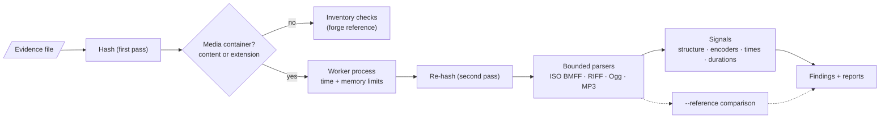

# ADR 0002 — Scope of RV AvAuth v0.1 and the assumptions behind it

- Status: accepted (owner request in rv-hub issue #11, built by an agent; this record lists every assumption so the owner can overturn any of them)
- Date: 2026-11-17
- Deciders: the owner (scope), the build agent (assumptions marked **A-n**)

## Context

Issue #11: "Audio and video authenticity signals. Checks container structure (MP4/MOV, OGG/Opus, WAV, MP3) and encoder
traces; ENF analysis comes later." The tool follows RV ImgAuth (authenticity signals for images) and RV PDFAuth
(structure analysis in an isolated worker): signals, never verdicts; the forensic plumbing of the forge (audit chain,
hashing, reports, custody forms, case folder) is unchanged. ADR 0001 chose Rust.

## Decision

| Area | v0.1 decision |
| --- | --- |
| Main verb | `analyze` (`scan` kept as a hidden alias); `.forge.json` `run_command = analyze` |
| Case role | analysis: registered evidence is re-hashed and verified against the case registry (as RV ImgAuth / RV PDFAuth) |
| Containers | ISO BMFF (MP4, MOV, M4A, 3GP), RIFF/WAVE and RF64, Ogg (Opus, Vorbis; Theora/FLAC/Speex identified only), MPEG audio layer III with ID3v1/ID3v2/APEv2 |
| Parsers | own pure-Rust crate `rv-avauth-media`, `#![forbid(unsafe_code)]`, no third-party parser; every read checked against the real file length and a cap (4 MiB per structure); hard limits on nodes, tags, chunks, pages (2 000 000), frames (2 000 000), nesting (16) |
| Isolation | one worker process per media item (same executable, `worker` sub-command), Job Object / `RLIMIT_AS`, default 120 s and 1024 MiB |
| Signals | 37 media finding codes; none is `high` (high stays reserved for a failed analysis, evidence that changed during the run or differs from the case registry, programs under another name) |
| Reference | `--reference FILE` (repeatable): structural fingerprint of 11 aspects, `REFERENCE_CONSISTENT` / `REFERENCE_DIFFERS` |
| Outputs | `structure.json`, `metadata.json`, `reference-comparison.json` per item, hashed and audited |
| Not in v0.1 | ENF, decoding or listening to content, speaker / deepfake analysis, Matroska/WebM, FLAC, AVI, raw AAC/AMR; printed as limitations on every report |

## Assumptions (to be confirmed or overturned by the owner)

| # | Assumption | Why | How to revisit |
| --- | --- | --- | --- |
| A-1 | No ffmpeg/libav and no third-party media parser: all parsing is our own code. | GPL/LGPL excluded by the owner; the parsers are small enough to audit; no native library to pin. | Swap a module for a permissive crate (e.g. `mp4`, MIT) only after a licence and fuzz review. |
| A-2 | The analysis never decodes audio or video. | Scope of #11 is structure and encoder traces; decoding needs codecs (licensing, attack surface). | ENF and content analysis come in a later version with their own ADR. |
| A-3 | All media severities are `info`, `low` or `medium`. | The tool is validated on synthetic files only; a structural oddity has innocent explanations. | Raise a severity only with a validated device corpus and a documented error rate. |
| A-4 | Thresholds: durations differ when > 5 % **and** > 200 ms; track vs movie creation > 60 s; modification before creation > 2 s; tag dates and file-system dates ± 26 h. | Avoid rounding, timescale and time-zone noise (tags are often local time). | Measure on real recordings per device family; the constants are in `src/media/src/signals.rs`. |
| A-5 | `moov` after `mdat` is reported as `info` only (MOOV_AFTER_MDAT), not as a contradiction with the brand. | No verified table of which recorder writes which layout; phones and FFmpeg both write moov last by default. | Use `--reference` for the claimed device; add a per-device expectation table once verified. |
| A-6 | The encoder table (`src/media/src/encoders.rs`) is small and conservative; FFmpeg/Lavf is a `transcoder` (low), editors and online converters are `medium`. | Many apps and messengers embed FFmpeg; a Lavf string alone says the container was written by FFmpeg, not that content was edited. | Extend the table with sourced strings; keep a test per entry. |
| A-7 | Handler names `SoundHandler`/`VideoHandler` (FFmpeg), `SoundHandle`/`VideoHandle` (Android MPEG4Writer), `Core Media Audio/Video` (Apple) are recognised by exact match. | Commonly observed defaults of those muxers. | **To be verified** against device originals; until then they are only shown as encoder traces with `info`/`low` weight. |
| A-8 | No WhatsApp-specific box or string is claimed. | None could be verified without real files; the tool only reports a messenger when a string names it. | Add a trace when a verified sample corpus exists. |
| A-9 | ISO BMFF times are read as seconds since 1904-01-01 UTC and converted with integer arithmetic; tag texts without a zone are read as if UTC with the 26 h tolerance. | ISO/IEC 14496-12 defines UTC; the suite is migrating from chrono to jiff, so no new chrono code. | — |
| A-10 | File-system times come from the examined copy (the parent's `stat` before hashing). | The tool never sees the original medium. | Documented as limitation `TIMESTAMPS_FROM_FILESYSTEM`. |
| A-11 | Sample evidence is synthetic and generated byte by byte by `tests/make_samples.py` (sine tone, filler bytes); software names appear as plain strings. | Owner rule: no real recordings, no voices, no personal data. | — |
| A-12 | `--reference` compares structure only (11 aspects; digits in encoder strings ignored so minor versions do not count as a different writer). | A reference from the same device, app version and settings is the strongest available comparison without content analysis. | Add aspects (sample-table patterns, chunk sizes) when validated. |
| A-13 | MP3 frames are all walked (up to 2 000 000) instead of a sample. | Exact duration and gap detection; the walk reads 4 bytes per frame through a 256 KiB window. | Lower the cap if very long files are too slow (not measured on multi-hour files). |
| A-14 | The GUI gets two domain settings (reference file, worker time limit) audited as `ui_reference_changed` and `ui_worker_timeout_changed`; memory limit stays at the default. | Keep the window simple; the CLI exposes `--worker-memory`. | — |

## Consequences

- Every media file costs a second read of the evidence (the re-hash in the worker); this is logged (`analysis_started`).
- Results describe structure and metadata only; reports print the seven media limitations on every page.
- Not verified in v0.1: real device files, files larger than a few kilobytes, multi-hour recordings, fragmented MP4 from
  cameras, RF64 above 4 GiB. These are the first items of the next version's test plan.
