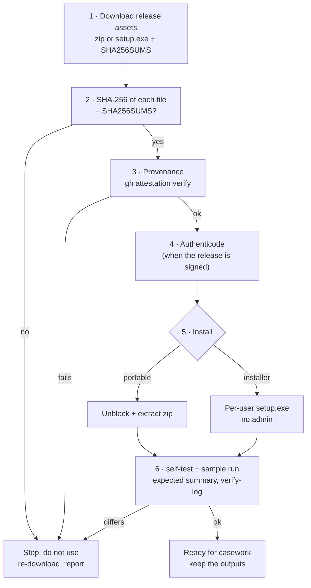

<!--
  Template note for the docs agent of a tool scaffolded from rv-avauth: steps 1–5 and 7–11 are shared (release
  assets, verification, installer, offline use, build from source, uninstall). Rewrite the parts between
  forge:domain markers: native libraries the tool needs, and the expected result of the sample run.
-->

# Installation and verification (Windows 10/11)

RV AvAuth runs **locally** on the examiner's Windows 10 or 11 PC (x64). It needs no administrator rights, no
runtime (static C runtime) and no network, except for the optional RFC 3161 timestamp. This page covers: getting a
release, **proving it is the genuine build**, installing it (portable zip or per-user installer), the first-run
self-test, offline use, building from source for auditors, where files live, and uninstalling.

Why verification matters: a court may ask how you know the program you ran is the one whose source an expert
reviewed. Steps 2–4 and 6 produce that answer; keep their output with the case file
([admissibility.md](admissibility.md#examiner-checklist-before-filing-a-report), step 3).



## Requirements

| Item | Requirement |
| --- | --- |
| Operating system | Windows 10 or 11, x64 (`MinVersion=10.0`, `ArchitecturesAllowed=x64compatible` in the installer). Linux/macOS: build from source. |
| Rights | Standard user. The installer is per-user (`PrivilegesRequired=lowest`). |
| Disk | The two executables and the docs (a few MB); outputs need about 11 report files per item for one language (19 with `--lang all`) plus the logs. |
| Memory | Files are streamed in 1 MiB chunks: memory use does not grow with file size. |
| Graphics | None required: the GUI also runs on VMs without a GPU driver (software rendering). |
| Network | None, except the optional timestamp request (see [step 7](#7-offline-and-air-gapped-use)). |

## 1. Download

Release assets on the GitHub Releases page of the repository (`Panacota96/rv-avauth`):

| Asset | What it is |
| --- | --- |
| `rv-avauth-X.Y.Z-windows-x64.zip` | Portable: `rv-avauth.exe`, `rv-avauth-gui.exe`, README, LICENSE, NOTICE, CHANGELOG, `docs/`, `examples/` |
| `rv-avauth-X.Y.Z-windows-x64-setup.exe` | Inno Setup installer, per-user |
| `SHA256SUMS` | SHA-256 of the zip, the installer and the SBOM (`sha256sum` format: `<hash>  ./<file>`) |
| `sbom.cdx.json` | CycloneDX software bill of materials (every Rust dependency and version) |

Put them in one folder, e.g. `C:\Rakvor\downloads\rv-avauth-0.1.0\`.

## 2. Verify the download

```powershell
cd C:\Rakvor\downloads\rv-avauth-0.1.0
Get-Content .\SHA256SUMS | ForEach-Object {
    $hash, $name = $_ -split '\s+', 2
    $name = $name.TrimStart('*').Replace('./', '')
    if (Test-Path $name) {
        $actual = (Get-FileHash -Algorithm SHA256 $name).Hash.ToLower()
        if ($actual -eq $hash) { "OK    $name" } else { "FAIL  $name  (got $actual)" }
    } else { "skip  $name (not downloaded)" }
}
```

```bash
sha256sum -c --ignore-missing SHA256SUMS      # Linux, or Git Bash on Windows
```

Every downloaded file must print `OK`. `SHA256SUMS` is produced by the same workflow and is not attested itself:
step 3 is the stronger check.

## 3. Verify build provenance

Each zip and installer carries a GitHub build-provenance attestation (`actions/attest-build-provenance`): a signed
statement that this exact file was built by the repository's release workflow from a given commit. On a machine
with internet access and the GitHub CLI:

```powershell
gh attestation verify .\rv-avauth-0.1.0-windows-x64.zip --repo Panacota96/rv-avauth
gh attestation verify .\rv-avauth-0.1.0-windows-x64-setup.exe --repo Panacota96/rv-avauth
```

The output names the workflow (`.github/workflows/release.yml`) and the source commit; record both. For an
air-gapped lab, verify on a connected machine and carry the verified files on write-protected media (the GitHub CLI
can also download the attestation bundle and trusted root for offline checks; see `gh attestation verify --help`).
`SHA256SUMS` and the SBOM are not attested.

## 4. Verify the Authenticode signature (signed releases)

The release workflow signs `rv-avauth.exe`, `rv-avauth-gui.exe` and the installer **only when a code-signing
certificate is configured** for the repository. Releases are signed with Rakvor's **internal** code-signing
certificate ("Rakvor Code Signing (internal)", issued by "Rakvor Internal Code Signing Root CA"). It is not a public
certificate: Windows trusts it only on machines where the Rakvor root is installed — Rakvor's own laptops, since the
tool is used locally and not distributed. Auditors and customers verify releases with steps 2–3 and can inspect the
signature with the root's fingerprint below.

Install the root once per Rakvor machine (PowerShell as the user who runs the tool; the file is
`packaging/signing/rakvor-code-signing-root.cer` in the repository):

```powershell
# Check the fingerprint first — it must be exactly:
#   SHA-256 DC9BA1A2FCD4F0633C5214B7CCEB25BED8F3F7D9EBAF111590250CBCAA83DF60
(New-Object System.Security.Cryptography.X509Certificates.X509Certificate2 .\rakvor-code-signing-root.cer).GetCertHashString([System.Security.Cryptography.HashAlgorithmName]::SHA256)
Import-Certificate -FilePath .\rakvor-code-signing-root.cer -CertStoreLocation Cert:\CurrentUser\Root
```

Windows shows a confirmation dialog for the new root; accept it only if the fingerprint matched. Without the root,
`Get-AuthenticodeSignature` reports `UnknownError` (chain to an untrusted root) and SmartScreen may still warn on
first run. Check:

```powershell
Get-AuthenticodeSignature .\rv-avauth-0.1.0-windows-x64-setup.exe |
    Format-List Status, StatusMessage, SignerCertificate, TimeStamperCertificate
# after extracting the zip:
Get-AuthenticodeSignature .\rv-avauth.exe, .\rv-avauth-gui.exe | Format-Table Status, Path
```

| Status | Meaning |
| --- | --- |
| `Valid` | Signed and intact; the signer must be "Rakvor Code Signing (internal)" |
| `UnknownError` | Signed, but the Rakvor root is not installed on this machine (install it as above) |
| `NotSigned` | The release was built without a signing certificate: rely on steps 2–3; Windows SmartScreen will warn |
| `HashMismatch` / other | Stop: the file was altered after signing |

With the Windows SDK, `signtool verify /pa /v rv-avauth.exe` gives the full chain.

## 5. Install

### 5a. Portable zip

```powershell
# only after steps 2–4
Unblock-File .\rv-avauth-0.1.0-windows-x64.zip
Expand-Archive .\rv-avauth-0.1.0-windows-x64.zip -DestinationPath C:\Rakvor\tools\rv-avauth-0.1.0
cd C:\Rakvor\tools\rv-avauth-0.1.0
.\rv-avauth.exe --version
```

Keep one folder per version so a past case can be re-run with the exact version recorded in its
`environment.json`. Optional, current session only: `$env:Path += ";C:\Rakvor\tools\rv-avauth-0.1.0"`.

### 5b. Installer (per-user, no administrator)

Double-click `rv-avauth-X.Y.Z-windows-x64-setup.exe` (English, Spanish or French wizard). It installs to
`%LOCALAPPDATA%\Programs\Rakvor\RV AvAuth\`, creates a *Rakvor* Start-menu group (app + documentation), and offers
two tasks: **Add the rv-avauth command to PATH** (user PATH, checked on first install) and a desktop icon. Open a
**new** terminal afterwards for PATH to apply.

Unattended:

```powershell
.\rv-avauth-0.1.0-windows-x64-setup.exe /VERYSILENT /SUPPRESSMSGBOXES /NORESTART /TASKS="addtopath"
```

The installer copies the executables, README, LICENSE, NOTICE, CHANGELOG, `docs\` and the sample evidence
(`examples\sample\evidence\`), not the sample scripts or `expected_hashes.csv` (those are in the zip and the source
tree).

<!-- forge:domain -->
### 5c. Native libraries

None. RV AvAuth is two self-contained executables: hashing, the media container parsers (own pure-Rust code, no
FFmpeg or codec library), the PDF writer, the RFC 3161 client and the CMS signer are compiled in (pure Rust crates,
listed in the SBOM), and the C runtime is linked statically (`.cargo/config.toml`). There is no DLL to verify or to
keep next to the executables. The media analysis runs in a child process of the same executable
(`rv-avauth.exe worker …`); antivirus tools may show it as a second `rv-avauth.exe` process during a run.
<!-- /forge:domain -->

## 6. First-run self-test and sample

```powershell
rv-avauth --version
rv-avauth self-test
```

`self-test` prints `PASS` for md5, sha1, sha256, sha512, sha3-256 and blake3 (known answers for `"abc"`), exit code
0. It tests the hash implementations only. Then run the synthetic sample, which exercises the media parsers,
the worker isolation, reports and the audit chain:

```powershell
# portable zip (script included): self-test, sample scan, verify-log, hashes.csv vs expected_hashes.csv
.\examples\sample\run.ps1 -Bin .\rv-avauth.exe

# installer (no script installed): run it by hand into a temporary folder
$app = "$env:LOCALAPPDATA\Programs\Rakvor\RV AvAuth"
$out = Join-Path $env:TEMP "rv-avauth-check"
rv-avauth analyze -i "$app\examples\sample\evidence" --hash sha256,md5 --out $out --progress none --no-timestamp
$LASTEXITCODE                                  # 0
rv-avauth verify-log (Get-ChildItem "$out\logs" | Select-Object -Last 1).FullName   # OK … chain intact
```

<!-- forge:domain -->
Expected summary: **22 items, 0 errors, findings high 0, medium 21, low 11, info 33**, exit code 0 (the codes per
file are listed in `examples\sample\expected_findings.json` and in [examples/README.md](../examples/README.md)). The
SHA-256 column of `hashes.csv` must equal `examples\sample\expected_hashes.csv` (computed independently with Python):

| File | Size | SHA-256 |
| --- | --: | --- |
| `bad-fmt.wav` | 8044 | `2a9fdfaaa676bcb23a6287a8d47dbf67054cabbc29e776e68c6a1faea497607c` |
| `broken-box.mp4` | 508 | `8b8222a8797a6a43e5a55e4c354d2bbc80483bf0e53da98cf692fbe41825dad7` |
| `camera-edited.mov` | 8947 | `bd4eea53f0f3f205a7730de196c72d794439d62f775a8a72e0eb92e8752481fc` |
| `camera-original.mov` | 8908 | `254d29eb4597ceb24ef61eb80be8f6003b57775b771ef0d7f6650b4a10e13968` |
| `camera-renamed.mp4` | 8908 | `30c64e55f76721ade9f5f79c6de056f6ba8c8b9a05986ee0a0ec24298f43ff3b` |
| `chained.ogg` | 698 | `d6f24a015f98a75ae21009f955752b25482adfc392028a23b1efb59d349d74e5` |
| `duration-mismatch.mp4` | 8605 | `4592193872ccae97969bfa5d9e413cd37cc5fea72ab0ccad2ccc8aaf8717cd88` |
| `empty.wav` | 0 | `e3b0c44298fc1c149afbf4c8996fb92427ae41e4649b934ca495991b7852b855` |
| `memo-converted.mp3` | 8860 | `652bcc31f2d8d7cf1b14a395f5c902faf8e8c346ee75c1d203023f829d7da538` |
| `memo-lame.mp3` | 8845 | `0960d7790b02a2f9b7465122b6bb07ea92544fcf135d9f056bf7695804d36848` |
| `memo-spliced.mp3` | 6550 | `96a830ca6182210917e31da8834da7601c119d4d02ae33e73dba3da83a04c2c8` |
| `memo-truncated.mp3` | 4370 | `4317a691facb577a74ca21c4499abf02c2c44b33efb8ba436ce4a247d3b41123` |
| `notes.txt` | 52 | `21a46d32a5b74e8723bfdfeaa46ed3aff34b7560a3ea7c2de894f260eda246a8` |
| `renamed-wave.mp3` | 8044 | `6447655c6c4cf7c218dca1c7d4c7eb8fea996a57d594aed5dd2b7c6a6a157a87` |
| `tone-appended.wav` | 10092 | `abcf6e36ca959922734e7b51847d989ed7eca6eda1880f0f1321c8aea4d94b41` |
| `tone-edited-audacity.wav` | 8710 | `9f52333f186f5e8010d76f9680e5d21670787823f9a073641ecab73dfbb99415` |
| `tone-original.wav` | 8710 | `08dd5a8ddd337dde79ef6eca4ff954b4a2f2cb713f363f3b840f0b10b0a499b3` |
| `tone-truncated.wav` | 4044 | `8aef037ccc0ff27c472096d1b668f9f1461b653a45b10a60a99eabb15ffb6f19` |
| `voice-note-spliced.opus` | 339 | `7c364dc0a198c8f1ed2758ddb310018eae099da5171998d314a1ed0242a46326` |
| `voice-note-truncated.opus` | 223 | `b3bb0f569d1d464f71ed285efcca67d7c783ba5d48620df7f6856b74c0b1e863` |
| `voice-note.opus` | 243 | `29976f39fbcd39bde3daad92b3c0034300f4b9c68abedfcd64a1aaa94b68c68e` |
| `voice-reencoded.m4a` | 8655 | `1548b79cff855b81beb60c5fa692eef09a6dd1eb7cf7287c8e171b44bddbee6a` |

`run.ps1` / `run.sh` make this comparison themselves: they read the tool's `logs\<RUN-ID>\hashes.csv` and compare
size, SHA-256 and MD5 of every file with `expected_hashes.csv`, print
`hashes.csv matches expected_hashes.csv (22 files: size, SHA-256, MD5)` and exit 3 on any difference. For the
installer (no script installed), compare the table above with `$out\logs\<RUN-ID>\hashes.csv`, or run
`python tests\verify_chain.py <log folder>` from the source tree, which re-hashes every file of `hashes.csv` and every
output the audit log records.
<!-- /forge:domain -->

Keep the console output and the run folder as the record of this verification.

## 7. Offline and air-gapped use

The **only** network access in the code is the RFC 3161 timestamp request (one HTTP POST of a 32-byte hash to the
TSA, [src/core/src/trust.rs](../src/core/src/trust.rs)). There is no telemetry, update check or licence check.

| To disable the timestamp | How |
| --- | --- |
| One CLI run | `--no-timestamp` |
| All CLI runs on this PC / session | `$env:RV_NO_TIMESTAMP = "1"` (or set it as a user environment variable) |
| GUI | untick **4. Trust → Trusted timestamp** before *Start review* |

An offline run with the timestamp enabled still completes: it logs `timestamp_pending` and the statistics report
shows a warning. Later, on a machine that can reach the TSA, run `rv-avauth timestamp <log folder>` (it
re-verifies the chain, then appends `timestamp_obtained`). To use an internal or qualified TSA, pass `--tsa-url`
(see [admissibility.md](admissibility.md#53-eidas--regulation-eu-9102014-as-amended-by-eu-20241183)). The network
restriction is not enforced by the OS; on a connected workstation, a Windows Firewall outbound rule for
`rv-avauth.exe` / `rv-avauth-gui.exe` allowing only the TSA host enforces it.

## 8. Build from source for auditors

### Toolchain

| Item | Version |
| --- | --- |
| Rust | Pinned by [rust-toolchain.toml](../rust-toolchain.toml): **1.97.0** with rustfmt and clippy; `rustup` installs and selects it automatically inside the source tree. `Cargo.toml` declares `rust-version = "1.88"` (edition 2024) as the minimum. To match a release exactly, use the compiler recorded in that release's `environment.json` → `tool.rustc` (e.g. `rustc 1.97.0 (2d8144b78 2026-07-07)`). |
| Windows linker | Visual Studio 2022 Build Tools, workload *Desktop development with C++* (MSVC + Windows SDK); target `x86_64-pc-windows-msvc`. Static CRT is set in `.cargo/config.toml`. |
| Linux | No system packages needed to build the CLI. |
| Optional | Python 3.12 with `blake3 jsonschema pyhanko` for the independent verifiers and the trust tests (`RV_TEST_PYTHON=python`). |

### Build

```powershell
git clone https://github.com/Panacota96/rv-avauth.git
cd rv-avauth
git checkout v0.1.0                       # the tag of the release under review
rustc --version                           # must print the pinned 1.97.0
cargo build --release --locked -p rv-avauth-cli -p rv-avauth-gui
.\target\release\rv-avauth.exe self-test
.\examples\sample\run.ps1 -Bin .\target\release\rv-avauth.exe
cargo test --workspace --locked            # unit + integration tests (trust tests skip without pyhanko)
```

```bash
# Linux
cargo build --release --locked -p rv-avauth-cli
target/release/rv-avauth self-test && examples/sample/run.sh target/release/rv-avauth
python3 tests/verify_chain.py examples/sample/out/logs/$(ls examples/sample/out/logs | tail -n 1)
# cross-profile: a case folder written by the Python profile must verify with this build
python3 tests/golden/unpack.py tests/golden/case-by-python.zip.b64 /tmp/golden
target/release/rv-avauth verify-case /tmp/golden/CASE-GOLDEN
```

`--locked` refuses to build if `Cargo.lock` would change, so the dependency set equals the one listed in
`environment.json` → `dependencies` and in `sbom.cdx.json`. The product version comes from `version.txt`; the
crate versions in `Cargo.toml` stay fixed, so a release never changes the lock file.

### Reproducing the release hashes

Be precise about what can and cannot match bit for bit in this version (gap G22):

| Artefact | Bit-identical to the release? | How to check |
| --- | --- | --- |
| `docs/`, `examples/` files | Yes (from git; LF line endings except `*.ps1`, `*.iss`) | `git ls-files` + `Get-FileHash` against the extracted zip |
| `rv-avauth.exe`, `rv-avauth-gui.exe` | **Not guaranteed**: paths are not remapped and the PE header carries link-time data. The compiler is the one pinned in `rust-toolchain.toml` (both workflows run `rustup toolchain install`, which reads that file; confirm with `environment.json` → `tool.rustc` of a release run) | Provenance attestation (step 3) binds the released binary to the workflow and commit; then compare behaviour (below) |
| zip, installer | No (archive timestamps) | Attestation (step 3) |

**Functional equivalence** — run the sample with the release binary and with your build, then compare the digests
and findings of every item:

```bash
python - "<release-out>/reports/<RUN-ID>" "<your-out>/reports/<RUN-ID>" <<'EOF'
import glob, json, sys
def load(run):
    out = {}
    for p in sorted(glob.glob(f"{run}/items/*/technical.json")):
        t = json.load(open(p, encoding="utf-8"))
        out[t["item"]["file_name"]] = (t["hashes"], t["item"]["detected_type"],
                                       [(f["code"], f["severity"], f["params"]) for f in t["findings"]])
    return out
a, b = load(sys.argv[1]), load(sys.argv[2])
print("identical findings and digests" if a == b else "DIFFERENT: " + ", ".join(k for k in a if a.get(k) != b.get(k)))
EOF
```

The same script compares this build with the Python profile of the tool (measured identical on the sample).

## 9. Where things live

| What | Location |
| --- | --- |
| Program (installer) | `%LOCALAPPDATA%\Programs\Rakvor\RV AvAuth\` (`rv-avauth.exe`, `rv-avauth-gui.exe`, `docs\`, `examples\sample\evidence\`, `unins000.exe`) |
| Program (portable) | the folder you extracted |
| PATH entry (installer task) | user environment variable `Path` (`HKCU\Environment`) |
| Run outputs | `--out` (default `.\rakvor-out` **relative to the current folder**): `logs\<RUN-ID>\`, `reports\<RUN-ID>\`. With `--case-dir`: `<CASE>\runs\rv-avauth\<RUN-ID>\`. The GUI uses its *Output folder* field (or the case folder) |
| Case folder | wherever you create it with `--case-dir` (`case.json`, `case-log.jsonl`, `evidence\`, `runs\`) |
| GUI settings | not persisted: each start uses the defaults; every change made before a run is recorded in that run's audit log (`ui_*`) |
| Signing certificate | wherever you keep it; only its path, subject and SHA-256 fingerprint are logged, never the password |
| Local data, caches, temporary files | none |

## 10. Uninstall

- **Installer:** *Settings → Apps → Installed apps → RV AvAuth → Uninstall*, or run
  `"%LOCALAPPDATA%\Programs\Rakvor\RV AvAuth\unins000.exe"`. It removes the installed files and shortcuts. The user
  **PATH entry is not removed** in this version; remove it with:

  ```powershell
  $dir = "$env:LOCALAPPDATA\Programs\Rakvor\RV AvAuth"
  $p = [Environment]::GetEnvironmentVariable("Path", "User").Split(";") | Where-Object { $_ -and $_ -ne $dir }
  [Environment]::SetEnvironmentVariable("Path", ($p -join ";"), "User")
  ```

- **Portable:** delete the folder.
- **Kept on purpose** (both cases): run outputs and case folders (case material). Keep the release zip and
  `SHA256SUMS` of every version used in a case, so it can be re-run.

## 11. Installation troubleshooting

| Symptom | Cause and fix |
| --- | --- |
| SmartScreen "Windows protected your PC" (unknown publisher) | SmartScreen judges a file by the **reputation** of a publicly trusted certificate; the internal Rakvor root is not one, so the warning appears even when the signature is `Valid` (and always when `NotSigned`). Only after steps 2–4 pass: *More info → Run anyway*, or remove the downloaded-file mark first with `Unblock-File .\<file>` (do this on the zip **before** extracting it). It goes away for good only with a public certificate (see `docs/release-process.md` §5). |
| `rv-avauth` is not recognised | PATH task not selected, or the terminal was opened before installing: open a new terminal or use the full path. |
| `self-test` prints `FAIL` | Do not use this build for evidence; re-download and repeat steps 2–4. |
| Sample summary differs from step 6 | Wrong version or modified sample files; compare `environment.json` with the release notes and the sample digests with `expected_hashes.csv`. |
| GUI window blank or very slow on a VM | No GPU driver: software rendering is used; give the VM more CPU. |
| Building from source downloads another compiler | Expected: rustup installs the pinned 1.97.0 from `rust-toolchain.toml`. Offline, install it beforehand (`rustup toolchain install 1.97.0 --profile minimal`). |
