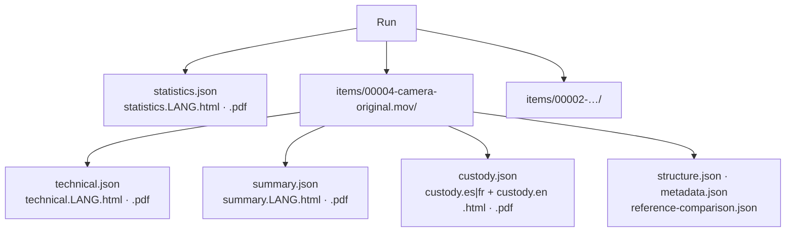
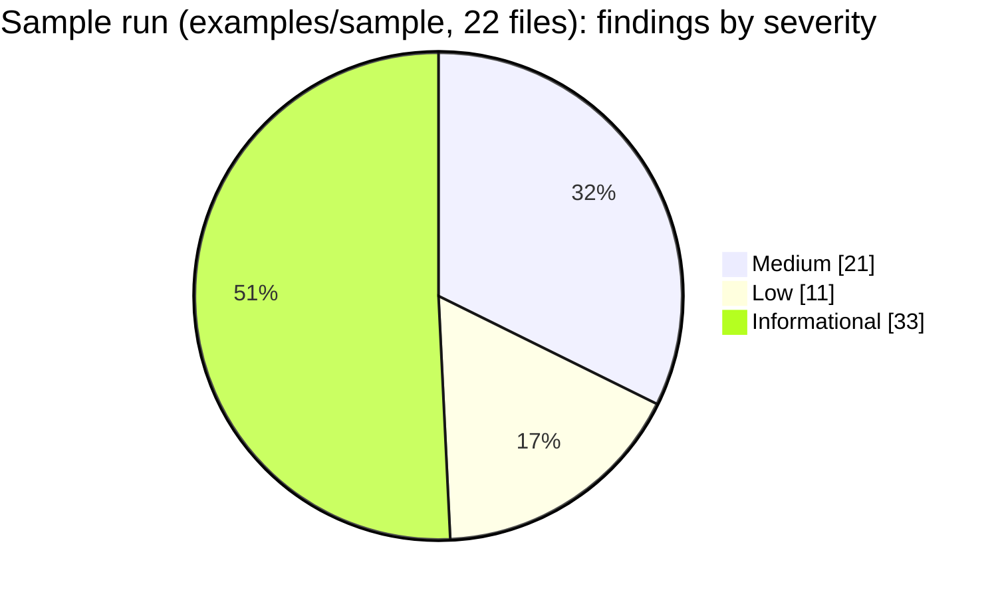

# Reports

Every run produces one **statistics report**. Every reviewed file produces **two separate reviews**:
a hyper-detailed **technical review** for examiners and lawyers, and a concise **customer summary** in plain
language. Each exists as JSON (machine-readable, language-neutral) plus HTML and PDF in each selected language.

Each item folder also holds a **chain-of-custody form** for the chosen jurisdiction (`--jurisdiction co|fr`)
plus its English version — see [forensic-audit.md](forensic-audit.md#chain-of-custody-form-per-item).

**Brand.** HTML and PDF reports carry the Rakvor header band (RV mark, descriptor
*FORENSICS | INCIDENT RESPONSE | SECURITY* and the tagline in the report language) on a light, printable page.
When `--sign-cert` is used, each report (PDF and HTML) shows the signer's certificate subject and its SHA-256
fingerprint — the value logged at `signing_certificate_loaded`, also in the JSON reports as
`run.pdf_signer_certificate_sha256` — and each PDF carries a digital signature that Acrobat or
`pyhanko sign validate` can check (the test suite validates every signed PDF with pyHanko). The statistics report shows the trusted timestamp (or a warning
that it is pending).

**Size.** Item reports never list every other file: duplicate partners are capped at 10 names
("… (+N)"); the complete groups are in the statistics report and `hashes.csv`.

## What each report contains

| Section | Statistics | Technical review | Customer summary |
| --- | :-: | :-: | :-: |
| Run ID, case, examiner, start/end, duration, interface | ✔ | ✔ (run ID, case) | case, date |
| Hash algorithms, totals, throughput | ✔ | | |
| Findings by severity and type, items by detected type | ✔ | | |
| Duplicate groups | ✔ | as finding | as finding |
| Full path, size, modified time, extension, detected type (container) | | ✔ | file name |
| Media analysis: status, second-read re-hash, isolation, container overview (brands, top-level boxes, mdat/moov, chunks, Ogg pages and streams, ID3/MPEG frames, Xing/Info) | | ✔ | |
| Streams, times, durations, encoder strings (classified), device claims, tags, structural anomalies, structure tree (≤ 120 nodes), reference comparison table | | ✔ | |
| Files written for the item (`structure.json`, `metadata.json`, `reference-comparison.json`) with digests | | ✔ | |
| All digests | | ✔ | primary only ("digital fingerprint") |
| Findings with **what it shows / what it does not prove** | | ✔ | plain sentence |
| Method | | ✔ | "What we did" |
| Audit entries covering the item | | ✔ (`#first – #last`) | |
| Limitations | ✔ | ✔ | |
| Status and next step | | ✔ | ✔ |

## Status and severity

| Severity | Examples | Item status |
| --- | --- | --- |
| High | PARSER_FAILED, EVIDENCE_CHANGED_DURING_ANALYSIS, EVIDENCE_HASH_MISMATCH_WITH_CASE, UNREADABLE, EXECUTABLE_CONTENT | `problem` (exit code 3) |
| Medium | structure (sizes, truncation, trailing data, Ogg CRC/sequence/granule, sync gaps, parameter changes), EDITING_SOFTWARE_TRACE, ONLINE_CONVERTER_TRACE, ENCODER_CONFLICTS_WITH_DEVICE_CLAIM, MEDIA_TIMES_INCONSISTENT, DURATION_MISMATCH, REFERENCE_DIFFERS | `attention` |
| Low | TRANSCODER_TRACE, MESSENGER_TRACE, MULTIPLE_MDAT, OGG_CHAINED_STREAMS, BRAND_EXTENSION_MISMATCH, time differences, MEDIA_NOT_RECOGNISED | `attention` |
| Informational | ENCODER_IDENTIFIED, DEVICE_CLAIM, VENDOR_TRACES, MOOV_AFTER_MDAT, METADATA_ABSENT, MEDIA_TIMES_ZERO, REFERENCE_CONSISTENT, EMPTY_FILE, DUPLICATE | `ok` |

No media signal is high: a structural oddity or a software name always has innocent explanations, and the
thresholds were validated on synthetic files only ([ADR 0002](adr/0002-scope.md), A-3).

## Findings catalogue

Generated from the English catalogue ([i18n/en.json](../i18n/en.json)); `%{…}` are the finding's parameters.

| Code (severity) | Shows | Does not prove |
| --- | --- | --- |
| `EMPTY_FILE` (info) | Empty file: The file contains no data (0 bytes). | It does not show whether the file was emptied deliberately or created empty. |
| `EXTENSION_MISMATCH` (medium) | Extension does not match content: The name ends in .%{extension} but the content starts with the signature of a %{detected} file. | Renaming is common and often innocent; it does not by itself prove an attempt to hide content. |
| `EXECUTABLE_CONTENT` (high) | Executable content under another name: The content is a %{detected} program although the name ends in .%{extension}. | It does not show that the program is malicious; analyse it in an isolated environment. |
| `DUPLICATE` (info) | Duplicate content: Identical content (same %{algorithm}) appears in %{count} files: %{others}. | Identical hashes show identical content, not who copied the file or when. |
| `UNREADABLE` (high) | File could not be read: Reading failed: %{error}. | It does not show that the file is damaged; permissions or locks can cause this. |
| `EVIDENCE_HASH_MISMATCH_WITH_CASE` (high) | Differs from the evidence registered in the case: The %{algorithm} of this file is %{actual}, but evidence %{evidence_id} was registered at intake with %{expected}: the file examined is not bit-identical to the registered item. | Who changed the file, when, or whether the change was deliberate; the analysis still ran so the examiner can decide. |
| `EVIDENCE_NOT_IN_CASE_REGISTRY` (medium) | Not registered in the case: No item of case %{case_id} was registered with this path or this content, so its continuity from intake cannot be shown. | That the file is altered or irrelevant; it may simply not have gone through intake. |
| `REGISTRY_PATH_CONTENT_CHANGED` (medium) | Registered path now holds different content: This path was registered earlier as %{previous_id} with other content; the current content gets a new evidence ID. | Which version is the original or why the content changed. |
| `PARSER_FAILED` (high) | Media analysis did not complete: The isolated analysis of this file stopped before finishing (reason: %{reason}, exit code %{exit_code}). The file was hashed and its integrity record is complete; its container was not fully examined. | It does not show that the file is malicious or manipulated: damaged, unusual or very large files can exhaust the time or memory limits. Re-run with higher limits or examine the file manually. |
| `EVIDENCE_CHANGED_DURING_ANALYSIS` (high) | Evidence changed during the analysis: The bytes read for the media analysis have %{algorithm} %{second_pass}, but the hashing pass recorded %{first_pass} for the same file: the file changed between the two reads, so the analysis results may not describe the hashed evidence. | Who or what changed the file (synchronisation software, antivirus, another program or a failing disk can all do it) or that the original evidence is altered; work on a write-protected copy and repeat the run. |
| `MEDIA_NOT_RECOGNISED` (low) | Media name, content not recognised: The name ends in .%{extension}, a media extension, but the content does not start like an MP4/MOV, WAVE, Ogg or MP3 file, so no container could be examined. | It does not prove the file was falsified: it may be damaged, encrypted, empty, or a format this version does not read (FLAC, Matroska, raw AAC…). |
| `CONTAINER_EXTENSION_MISMATCH` (medium) | Container does not match the extension: The content is a %{container} container, but the name ends in .%{extension}, which normally names another container. | Renaming or saving with the wrong extension is common and often innocent; it does not by itself prove editing or an attempt to deceive. |
| `BRAND_EXTENSION_MISMATCH` (low) | File brand does not match the extension: The ISO BMFF major brand is '%{brand}' (compatible: %{compatible}), which is unusual for a .%{extension} file (for example a QuickTime brand in an .mp4, or no 3GPP brand in a .3gp). | Many tools write generic brands, and renaming is common; it does not show which device or program wrote the file, nor that the content was changed. |
| `STRUCTURE_SIZE_INCONSISTENT` (medium) | Structure sizes do not add up: %{count} box, chunk or tag size field(s) do not fit their parent or the file; first at offset %{offset}: %{detail}. | Sizes that do not add up appear after editing tools rewrite part of a file, but also after transfer errors, recovery (carving) or buggy writers; it does not show what was changed or by whom. |
| `TRUNCATED_STREAM` (medium) | File or stream is cut off: %{count} structure(s) end before their declared size or end marker; first at offset %{offset}: %{detail}. | Truncation is typical of interrupted copies, downloads or recordings, and of partial recovery; it does not by itself show deliberate cutting of the content. |
| `FRAME_SYNC_GAPS` (medium) | Bytes between frames or pages: %{count} run(s) of bytes that are not part of the audio stream were found between frames or pages; first at offset %{offset}: %{detail}. | Gaps appear where two recordings are joined, but also with damaged copies, padding written by some encoders or tags embedded in odd places; it does not show where content was removed or inserted. |
| `OGG_CRC_MISMATCH` (medium) | Ogg page checksum does not match: %{count} Ogg page(s) carry a CRC-32 that does not match their bytes; first at offset %{offset}: %{detail}. | A wrong checksum shows the page bytes changed after the page was written — by editing, but equally by storage or transfer corruption; it does not show which. |
| `OGG_PAGE_SEQUENCE_GAP` (medium) | Ogg page numbers jump: %{count} time(s) the page sequence number of a logical stream does not follow the previous page; first at offset %{offset}: %{detail}. | Missing page numbers show that pages are absent or were reordered; a damaged copy or a recovery tool can cause it as well as editing. |
| `OGG_GRANULE_NOT_MONOTONIC` (medium) | Ogg time position goes backwards: %{count} time(s) the granule position (the stream's sample clock) is lower than on the previous page; first at offset %{offset}: %{detail}. | A clock that goes back is consistent with pages taken from elsewhere or reordered, but some muxers and damaged files show it too; it does not show what was heard or removed. |
| `OGG_CHAINED_STREAMS` (low) | Several Ogg streams one after another: A new logical stream starts after the previous one ended (chained Ogg, %{count} time(s)); first at offset %{offset}: %{detail}. | Chaining is how Ogg files are concatenated, by editors and also by streaming radio recorders; it does not show that the parts come from different recordings or were altered. |
| `STREAM_PARAMETERS_CHANGE` (medium) | Audio parameters change inside the stream: The sample rate, channel count or MPEG version changes inside one stream (%{count} time(s)); first at offset %{offset}: %{detail}. | A change of parameters is typical of joined recordings, but streaming captures and a few encoders produce it too; it does not show which part is original. |
| `FORMAT_PARAMETERS_INCONSISTENT` (medium) | Format header contradicts itself: Header fields that must agree do not (%{count} case(s)); first at offset %{offset}: %{detail}. | Contradictory header fields are written by hand-made or buggy tools and after header edits; ordinary players often ignore them, and they do not show that the audio was changed. |
| `PARSER_LIMIT_REACHED` (info) | Part of the file was not walked: A safety limit of the parser was reached (%{count} time(s)); first at offset %{offset}: %{detail}. The rest of that structure was not examined. | Limits protect the examiner's machine from hostile files; reaching one says nothing about authenticity, only that the examination of that part is incomplete. |
| `TRAILING_DATA` (medium (low when all zero)) | Data after the end of the container: %{bytes} bytes follow the logical end of the container at offset %{offset} (%{detail}). | Extra bytes are left by some editors and appenders, but also by copy tools, padding, recovery or concatenated downloads; they do not show what the bytes contain or who added them. Examine them separately. |
| `MULTIPLE_MDAT` (low) | Several media data boxes: The file holds %{count} 'mdat' boxes without being a fragmented MP4. | Some recorders and editors write several data boxes legitimately (for example after recovering an interrupted recording); it does not show that data was added from another file. |
| `MOOV_AFTER_MDAT` (info) | Index written after the media data: The movie index ('moov') follows the media data ('mdat'): layout %{layout}, brand '%{brand}'. Recorders that write while recording usually do this; files optimised for streaming put the index first. | Layout alone is not a sign of editing; compare it with a reference file from the claimed device (--reference), which is where a difference becomes meaningful. |
| `VENDOR_TRACES` (info) | Vendor-specific boxes or keys: Structures typical of particular vendors were found: %{traces}. | These structures can be copied or written by other software; they suggest which family of software touched the file, not which device recorded it. |
| `EDITING_SOFTWARE_TRACE` (medium) | Editing software named in the file: %{source} contains '%{value}', which names %{software}, an audio or video editor. | Editors are also used to cut, normalise or convert files for legitimate reasons (playback, sharing, archiving), and the string can be written or removed by anyone; it does not show what was changed. |
| `ONLINE_CONVERTER_TRACE` (medium) | Online conversion service named in the file: %{source} contains '%{value}', which names %{software}, an online conversion service: the file was most likely re-encoded or re-wrapped after it was recorded. | Conversion is often done only to make a file playable or smaller; it does not show that the content was edited, only that this file is not the first-generation recording. |
| `TRANSCODER_TRACE` (low) | Transcoder or multiplexer named in the file: %{source} contains '%{value}', which names %{software}: the file was written or re-wrapped by general-purpose conversion software. | FFmpeg-based libraries are built into many apps, messengers and even some recorders; this shows which software wrote the container, not that the content was edited. |
| `MESSENGER_TRACE` (low) | Messaging app named in the file: %{source} contains '%{value}', which names %{software}, a messaging app that re-encodes the media it sends. | Passing through a messenger is ordinary and changes the file without changing what it shows; it does not identify the sender or prove editing. |
| `ENCODER_IDENTIFIED` (info) | Encoder and writing-software strings: Strings naming the software or device that wrote the file: %{encoders}. | These strings are written by the software itself and can be changed, copied or removed; they are context for the examiner, not proof of origin. |
| `DEVICE_CLAIM` (info) | Device named in the metadata: The metadata names a recording device or device software: %{device}. | Anyone can write these fields, and editors often copy them from the original; they do not prove that this device recorded this file. Compare with a reference file from the device (--reference). |
| `ENCODER_CONFLICTS_WITH_DEVICE_CLAIM` (medium) | Re-encoding software next to a device claim: The metadata names a device (%{device}) but the file also carries a trace of %{software}, software that re-encodes or edits: this file is unlikely to be the device's first-generation recording. | Copies made for sharing, playback or archiving are often re-encoded while keeping the device tags; it does not show that the content was altered or what was changed. |
| `MEDIA_TIMES_ZERO` (info) | Internal times not set: %{count} creation/modification time fields of the container are zero (not set). | Many muxers leave these fields empty unless told otherwise, and some apps clear them for privacy; it does not show that dates were removed to hide something. |
| `MEDIA_TIMES_INCONSISTENT` (medium) | Internal times disagree: %{count} disagreement(s) between the movie, track and media header times (tolerance 60 s; a modification time may not precede its creation by more than 2 s): %{detail}. | Device clocks, time-zone handling and some muxers produce such differences; they show the times are not all original, not when or how the content changed. |
| `MEDIA_MODIFIED_AFTER_CREATION` (low) | Container modified after it was created: The movie header says it was created %{created} and modified %{modified}. | Software updates the modification time when it re-saves a file, including for harmless reasons (re-tagging, trimming silence, copying with some apps); it does not show what changed. |
| `TAG_TIME_DIFFERS_FROM_HEADER` (low) | Date tag differs from the internal creation time: %{tag_source} says '%{tag_time}', more than 26 hours away from the header creation time %{header_time}. | Tags are free text, often in local time and sometimes set by the user or by later software; the difference does not show which date is right. |
| `MEDIA_TIME_IN_FUTURE` (low) | Internal time later than the analysis: %{source} is %{time}, more than one day after this analysis ran. | A wrong device clock is the usual cause; it does not prove that the time was forged. |
| `FILE_TIME_BEFORE_MEDIA_TIME` (low) | File-system date earlier than the media date: The examined copy was last modified %{file_modified}, more than 26 hours before the time the media says it was made (%{media_time}). | File-system times change with copying and depend on the acquisition method, and device clocks can be wrong; it shows an inconsistency to explain, not which time is false. |
| `DURATION_MISMATCH` (medium) | Declared duration differs from the content: %{declared_source} declares %{declared_ms} ms but %{computed_source} gives %{computed_ms} ms (difference above 5 % and 200 ms). | Editing tools that cut a file without rewriting its header produce this, but so do interrupted recordings, VBR headers written before the end, and some encoders; it does not show where content is missing or added. |
| `METADATA_ABSENT` (info) | No metadata in the file: The %{container} file carries no tags, encoder strings or device fields. | Many recorders, converters and messengers write no metadata or strip it for privacy; absence is not evidence of tampering, it only removes context. |
| `REFERENCE_CONSISTENT` (info) | Structure matches the reference file: All %{aspects} compared aspects (container, brands, layout, codecs, parameters, handler names, encoders, tag keys, timescales, chunk/frame layout) match the reference %{reference}. | A matching structure is expected from the same device or app, but a careful forger or a lossless re-wrap with the same software can match too; it does not prove the file is original. |
| `REFERENCE_DIFFERS` (medium) | Structure differs from the reference file: %{count} aspect(s) differ from the reference %{reference}: %{differences}. | Firmware or app updates, other recording modes (quality, stereo/mono, video size) and settings change these aspects too; check that the reference really matches the claimed device, version and settings before drawing conclusions. |
| `REFERENCE_UNREADABLE` (low) | Reference file not usable: The reference %{reference} could not be compared: %{reason}. | This says nothing about the evidence; provide a readable reference in a supported container. |

## Limitations printed on every report

- `SIGNATURE_TABLE_LIMITED`: Type detection uses a limited table of common file signatures; unknown types are reported as unknown, not as suspicious.
- `TIMESTAMPS_FROM_FILESYSTEM`: Modification times come from the file system of the examined copy and may differ from the original source.
- `CLEAN_RESULT_IS_NOT_AUTHENTICITY`: A result without findings does not prove that a file is authentic or unaltered before acquisition.
- `TIMESTAMP_PROVES_EXISTENCE_ONLY`: A trusted timestamp proves the audit log existed in this exact form at the stated time; it does not prove that the examined copy matches the original source.
- `NO_ENF_ANALYSIS`: No electric network frequency (ENF) analysis is done in this version: the hum of the mains grid is not extracted or compared with grid records.
- `NO_CONTENT_OR_SPEAKER_ANALYSIS`: Audio and video content is never decoded: no listening, waveform, spectral, splice-in-content, deepfake or speaker analysis is performed. Findings come only from container structure and metadata.
- `METADATA_CAN_BE_FORGED_OR_STRIPPED`: Tags, encoder strings, device names and internal times are written by software and can be forged, copied or removed; a re-encode or a messenger usually destroys most of them.
- `ENCODER_TABLE_LIMITED`: Encoder strings are classified with a small built-in table (FFmpeg/Lavf, common editors, online converters, encoder libraries); unknown strings are listed but not classified.
- `CONTAINER_COVERAGE_LIMITED`: Only ISO BMFF (MP4/MOV/M4A/3GP), RIFF/WAVE, Ogg (Opus/Vorbis) and MP3 are parsed; FLAC, Matroska/WebM, AVI, raw AAC/AMR and others are not examined beyond hashing.
- `THRESHOLDS_NOT_VALIDATED_ON_DEVICE_CORPUS`: Tolerances (durations 5 % and 200 ms, header times 60 s, tag dates 26 h) and the handler-name table were tested on synthetic files only, not yet on a corpus of real device recordings.
- `REFERENCE_COMPARISON_LIMITS`: A reference comparison is only as good as the reference: it must come from the same device model, app version and recording settings, and its provenance must be documented by the examiner.

With `--case-dir` every report shows the item's **evidence id** (`E0001`…), the statistics report adds a *Case
folder* section (registered / verified / mismatched / not registered), and the custody form uses the case id, the
evidence id and the intake date — see [case-folder.md](case-folder.md).

Wording lives in `i18n/en.json`, `es.json`, `fr.json` (same keys in all three — enforced by a test).

## JSON schemas

| File | `schema` value | Schema |
| --- | --- | --- |
| `statistics.json` | `rakvor.statistics/1` | [schemas/statistics.schema.json](../schemas/statistics.schema.json) |
| `technical.json` | `rakvor.item-technical/1` | [schemas/item-technical.schema.json](../schemas/item-technical.schema.json) |
| `summary.json` | `rakvor.item-summary/1` | [schemas/item-summary.schema.json](../schemas/item-summary.schema.json) |

Adding a field is a minor change; removing or renaming one bumps the `/N` version.

## PDF notes

PDFs are generated by a small built-in writer (A4, Helvetica/Courier, WinAnsi encoding), so no external
program is needed on the examiner's PC. WinAnsi covers English, Spanish and French; other scripts would
need an embedded font (upgrade path: Typst). Every report file's digest is recorded in the audit log
(`item_reports_written`, `statistics_report_written`), so a report altered after the run can be detected.
