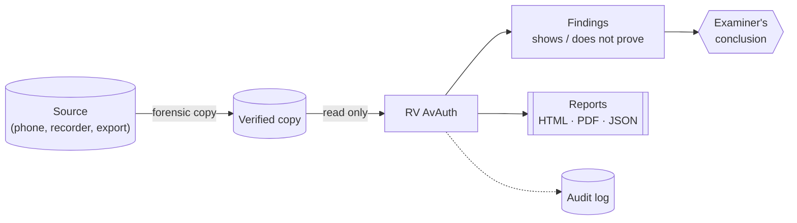
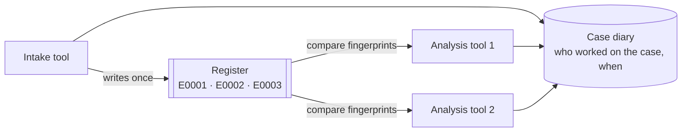
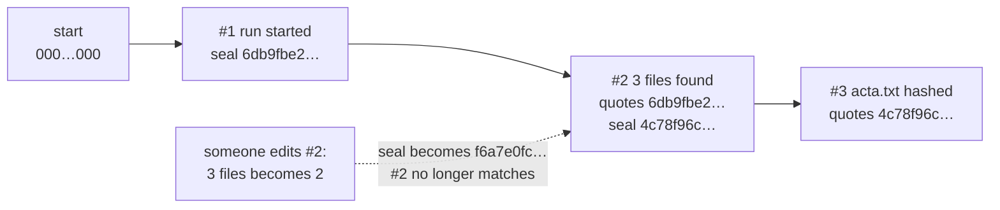
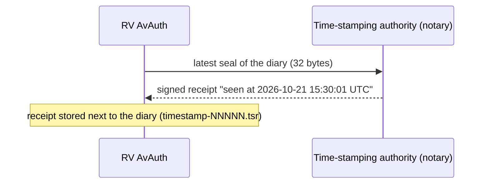
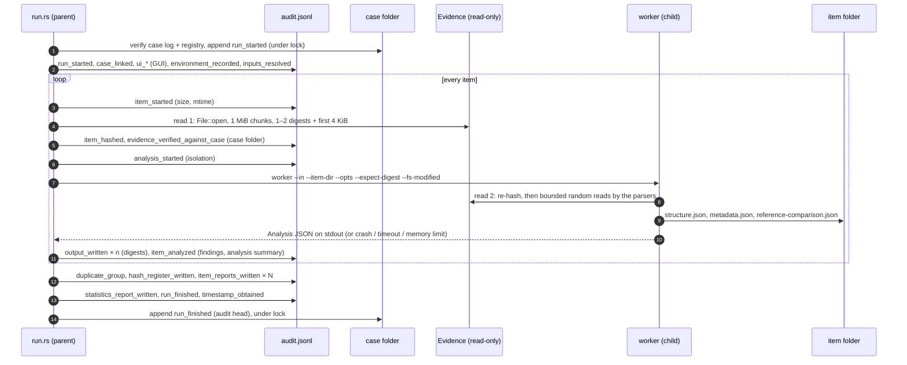
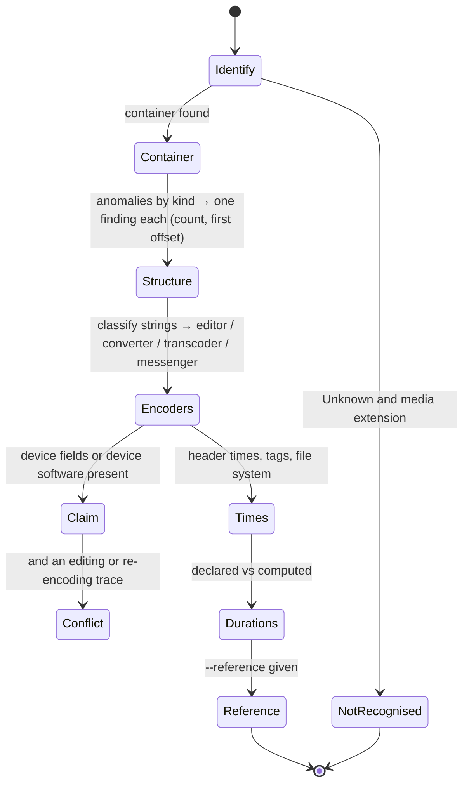
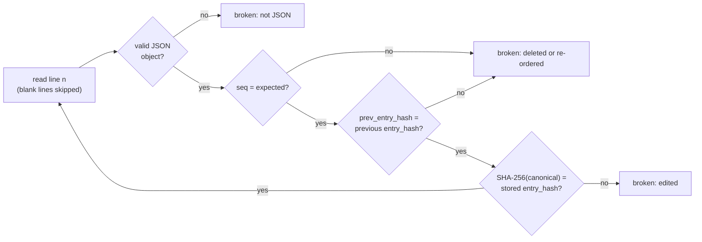
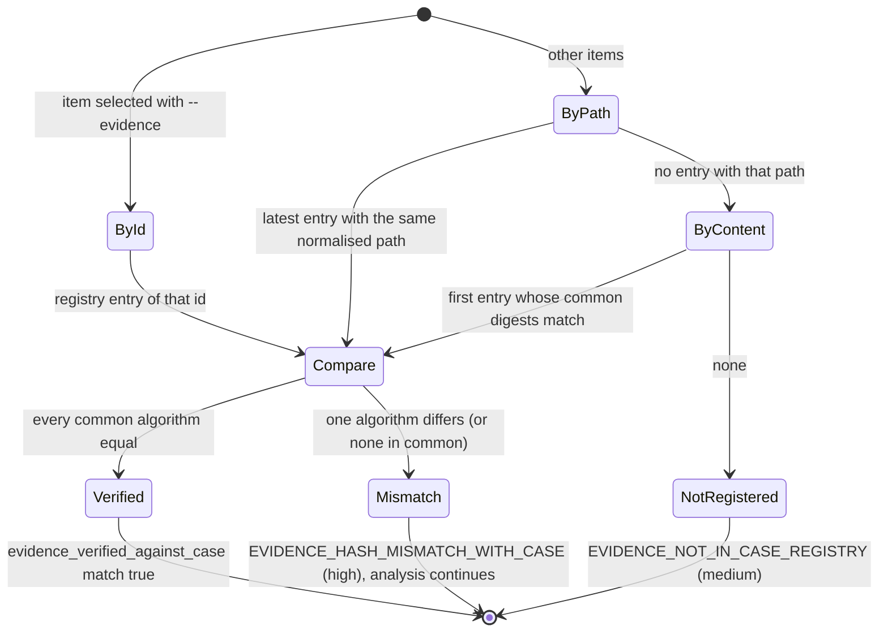
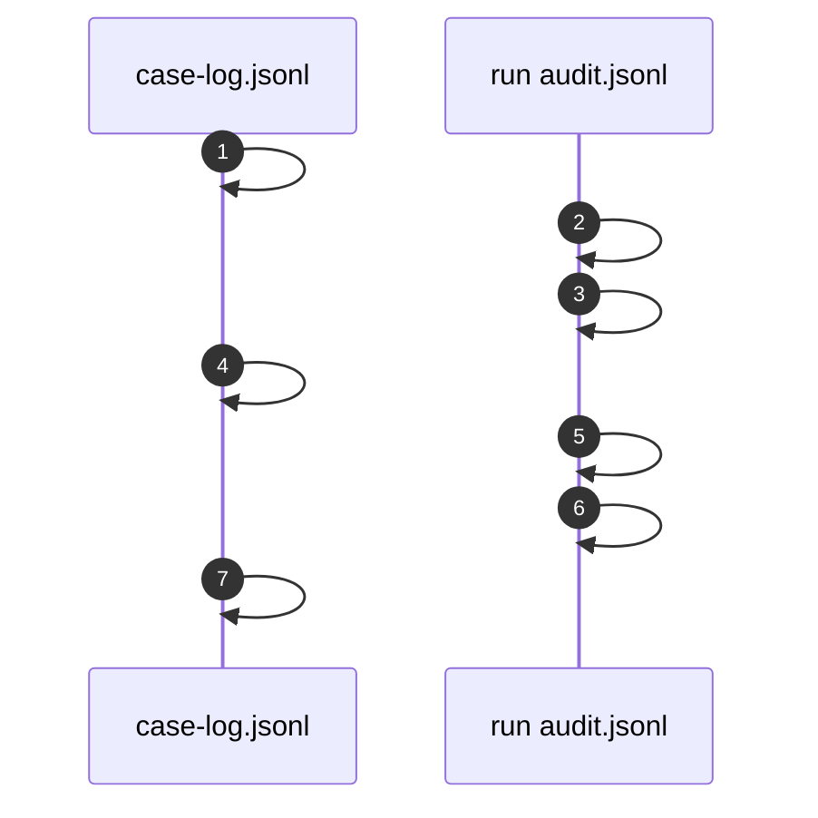
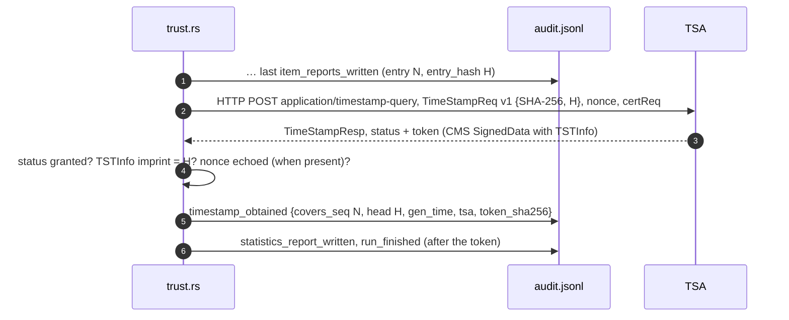

<!--
  Template note for the docs agent of a tool scaffolded from rv-avauth:
  sections between forge:domain markers describe what THIS tool does (inventory, file types, duplicates,
  intake role) and must be rewritten for the new tool. Everything outside the markers (hashing, audit chain,
  case folder, RFC 3161, signed PDFs, custody forms, determinism) is shared code: keep it, and re-check the
  numbers against the code. The scaffold replaces the tool name everywhere, so re-read any sentence that
  names the intake tool.
-->

# Theory of operation

This page explains **why** each step of RV AvAuth works, at two levels:

- **[Part A — For clients, lawyers and judges](#part-a--for-clients-lawyers-and-judges)**: plain language,
  analogies and pictures. No knowledge of computing or cryptography is needed.
- **[Part B — For examiners and opposing experts](#part-b--for-examiners-and-opposing-experts)**: algorithms,
  data structures, exact constants, the source file that implements each one, and the standards behind them.
  Every number in Part B is taken from the code of this commit or computed for this page with the tool itself;
  where the code and a standard or another page differ, Part B says so.

It describes what the tool **does**, not what it should do. Known weaknesses are stated where they apply and
collected in [admissibility.md](admissibility.md#consolidated-gap-list). How to run the tool:
[usage.md](usage.md). How to install and verify it: [installation.md](installation.md).

## Contents

- Part A: [A1 What the tool is](#a1-what-the-tool-is-and-is-not) ·
  [A2 Digital fingerprints](#a2-digital-fingerprints-hashes) ·
  [A3 Two fingerprints, one reading](#a3-two-fingerprints-one-reading) ·
  [A4 What the container tells](#a4-what-the-container-tells-about-a-recording) ·
  [A5 Identical copies](#a5-identical-copies) ·
  [A6 The case folder](#a6-the-case-folder-one-register-for-the-whole-case) ·
  [A7 The tool's own diary](#a7-the-tools-own-diary-the-audit-log) ·
  [A8 Proving when](#a8-proving-when-trusted-timestamps) ·
  [A9 Signed reports](#a9-signed-reports) ·
  [A10 Custody forms](#a10-custody-forms) ·
  [A11 Reading a clean result](#a11-what-no-findings-means)
- Part B: [B1 Source map](#b1-source-map-and-constants) ·
  [B2 Pipeline](#b2-pipeline-and-reads-of-the-evidence) ·
  [B3 Hashing](#b3-single-pass-dual-hashing) ·
  [B4 Media containers](#b4-media-container-parsing-and-signals) ·
  [B5 Duplicates](#b5-duplicate-detection-by-digest) ·
  [B6 Audit chain](#b6-the-audit-hash-chain) ·
  [B7 Case folder](#b7-the-case-folder) ·
  [B8 RFC 3161](#b8-rfc-3161-trusted-timestamp) ·
  [B9 Signed reports](#b9-signed-pdf-reports) ·
  [B10 Custody forms](#b10-custody-forms) ·
  [B11 Determinism](#b11-determinism-and-repeatability) ·
  [B12 What findings do not prove](#b12-what-each-finding-does-not-prove) ·
  [B13 References](#b13-references)

---

# Part A — For clients, lawyers and judges

<!-- forge:domain -->
## A1 What the tool is (and is not)

RV AvAuth looks at **how an audio or video file is put together** — the "envelope" around the sound or the
pictures — and at the **names and dates the software wrote into it**. A phone, a recorder app, an editor or a
converter each leaves its own habits: which boxes it writes and in which order, which software name it stores,
which clock it uses. When those habits do not fit together (a file that says it comes from a phone but was written
by an editing program, a duration that does not match the recording, bytes appended after the end), the tool
writes it down as a **finding**.

It never listens to the recording and never says "this file is genuine" or "this file is fake". Each finding says,
in plain words, **what it shows** and **what it does not prove**. Version 0.1 does **not** analyse the electric
network hum (ENF), the voices, or the content itself. The conclusion belongs to a human examiner.


<!-- /forge:domain -->

## A2 Digital fingerprints (hashes)

A **hash** is a short code computed from every byte of a file — a fingerprint. Change one character and the
fingerprint changes completely; keep the file identical and the fingerprint is the same on any computer, with any
correct program.

Real example (SHA-256), using the sample file `tests/fixtures/inventory/acta.txt` (61 bytes):

| Text (last line of the file) | SHA-256 fingerprint |
| --- | --- |
| `Firmado: Ana Ruiz` | `80e089ad6704c831e386b430adf92c5f5b72ec4428566d3580660e103c183c3c` |
| `Firmado: Ana Ruis` | `590570db76a9735f7b3782c73679fc6af6ac4041be4c41bcba1df0b648115523` |

One letter differs; the two fingerprints share nothing recognisable. This is why a hash proves that a file was
**not** changed: if today's fingerprint equals the one written down at intake, the file is the same, bit for bit.

## A3 Two fingerprints, one reading

The examiner may choose **one or two** fingerprint methods (for example SHA-256, the modern standard, plus MD5,
which older case files often use). The tool reads each file **once** and feeds every piece it reads to both
methods at the same time, like a cashier who scans each item once while two tills add it up. Both fingerprints
therefore describe exactly the same bytes. More than two methods at once are refused, so that the work stays
fast on very large folders.

<!-- forge:domain -->
## A4 What the container tells about a recording

An MP4, MOV, M4A, WAV, Ogg or MP3 file is a **container**: a sequence of labelled blocks ("boxes", "chunks",
"pages", "frames"), each saying how long it is. The sound or the video sits inside one of them; the others
describe it (format, duration, dates, the software that wrote the file).

The tool reads every block label and size, without decoding the sound, and checks that the pieces fit:

- **The envelope matches the name**: a `.mp3` that is really a WAV, or a `.mp4` with a QuickTime label.
- **The sizes add up**: a block that claims more bytes than its parent or the file, a file cut short, bytes
  after the end, an Ogg page whose checksum is wrong, page numbers that jump, a recording whose sample rate
  changes in the middle (typical of two recordings glued together).
- **The software is consistent**: the names the writing software left (for example "Lavf" for FFmpeg,
  "Audacity", "online-audio-converter.com", "LAME") are compared with the device the metadata names.
- **The dates and durations agree**: the creation dates of the movie and its tracks, date tags, the file
  system date, the duration the header announces and the duration the samples really last.

With a **reference file** that certainly comes from the claimed phone or app (same model, version and
settings), the tool compares eleven structural aspects of both files side by side.

Limits a court should know: every one of these traces can also have an innocent cause (a copy, a conversion
for sharing, a messenger, a buggy writer); software names and dates can be forged or removed; and the checks
were validated on synthetic files only (see [ADR 0002](adr/0002-scope.md)).
<!-- /forge:domain -->

## A6 The case folder: one register for the whole case

In a real case several Rakvor tools work one after the other. They share **one case folder**, which holds a
register of the evidence. The intake tool writes each file into it once, with its fingerprints and an evidence
number. Every later tool, before examining a file, takes its fingerprint again and compares it with the register:
same fingerprint, same evidence; different fingerprint, a high-severity warning.



The case folder also keeps a **case diary** in which every tool notes when it started and finished and the final
seal of its own diary (A7). The two diaries quote each other, so one cannot be edited without breaking the other.

## A7 The tool's own diary (the audit log)

Everything the tool does is written to a diary, `audit.jsonl`. Each line carries the seal (hash) of the line
before it, like numbered pages where every page quotes the seal of the previous page. Editing, inserting,
deleting or reordering a page breaks the seals from that point on, and `rv-avauth verify-log` (or an independent
Python script) detects it.



One honest limit: if the **last** pages are torn out, the remaining pages still agree with each other. That is
why the diary's final seal is also written in the case diary, printed in the reports and sent to a notary (A8).

## A8 Proving when: trusted timestamps

The diary proves its own consistency, not *when* it was written. For that, the tool sends the latest seal to a
**time-stamping authority** — an independent online notary — which signs "I saw this seal at 15:30:01 UTC on
21 October 2026". The notary never sees the evidence, only a 32-byte seal.



Without internet the run still finishes; the receipt can be requested later with `rv-avauth timestamp`. A
timestamp proves the diary existed at that time — not that its content is true.

## A9 Signed reports

With the examiner's certificate, every PDF report is digitally signed, so any later change to a report is
detectable with Adobe Reader or another validator. The HTML and JSON reports are not signed, but their
fingerprints are written in the diary, which is timestamped.

## A10 Custody forms

For every file the tool pre-fills a **chain-of-custody form** — Colombian style (Spanish) or French style (French),
always with an English copy — with the case number, the evidence number, the fingerprints and the times of the
work, and leaves empty rows for the people who hand over and receive the evidence to sign. It is an internal
record that accompanies, but does not replace, the official form of the police, prosecutor or court.

<!-- forge:domain -->
## A11 What "no findings" means

A file without findings is **not** proven authentic. It only means that the checks this tool applies found
nothing. Every report prints these limitations:

- Type detection uses a limited table of common file signatures; unknown types are reported as unknown, not as suspicious.
- Modification times come from the file system of the examined copy and may differ from the original source.
- A result without findings does not prove that a file is authentic or unaltered before acquisition.
- A trusted timestamp proves the audit log existed in this exact form at the stated time; it does not prove that the examined copy matches the original source.
- No electric network frequency (ENF) analysis is done in this version: the hum of the mains grid is not extracted or compared with grid records.
- Audio and video content is never decoded: no listening, waveform, spectral, splice-in-content, deepfake or speaker analysis is performed. Findings come only from container structure and metadata.
- Tags, encoder strings, device names and internal times are written by software and can be forged, copied or removed; a re-encode or a messenger usually destroys most of them.
- Encoder strings are classified with a small built-in table (FFmpeg/Lavf, common editors, online converters, encoder libraries); unknown strings are listed but not classified.
- Only ISO BMFF (MP4/MOV/M4A/3GP), RIFF/WAVE, Ogg (Opus/Vorbis) and MP3 are parsed; FLAC, Matroska/WebM, AVI, raw AAC/AMR and others are not examined beyond hashing.
- Tolerances (durations 5 % and 200 ms, header times 60 s, tag dates 26 h) and the handler-name table were tested on synthetic files only, not yet on a corpus of real device recordings.
- A reference comparison is only as good as the reference: it must come from the same device model, app version and recording settings, and its provenance must be documented by the examiner.
<!-- /forge:domain -->

---

# Part B — For examiners and opposing experts

## B1 Source map and constants

| Process | Implementation | Key constants (value in this commit) |
| --- | --- | --- |
| Input collection | [src/core/src/input.rs](../src/core/src/input.rs) | folders 1 level unless `--recursive`; symbolic links never followed; paths made absolute and lexically normalised, de-duplicated, sorted by that string bytewise (UTF-8; same rule as the Python profile), numbered from 1; a UTF-8 BOM at the start of an `--input-list` file is ignored |
| Log verification | [src/core/src/verify.rs](../src/core/src/verify.rs) | chain + timestamps + truncation anchors (timestamp `covers_seq`, case log `run_finished`) |
| Hashing | [src/core/src/hash.rs](../src/core/src/hash.rs) | `CHUNK` = 1 MiB (1 048 576 bytes); `MAX_SELECTED` = 2; head kept for detection = first 4 096 bytes; known answers for `"abc"` |
| Pipeline | [src/core/src/run.rs](../src/core/src/run.rs) | progress events every 150 ms; run id = `YYYYMMDDTHHMMSSZ-` + 6 hex of SHA-256(clock, pid, host) |
| Audit chain | [src/core/src/audit.rs](../src/core/src/audit.rs), [tests/verify_chain.py](../tests/verify_chain.py) | genesis = 64 zeros; SHA-256 over canonical JSON |
| Case folder | [src/core/src/case.rs](../src/core/src/case.rs) | schemas `rakvor.case/1`, `rakvor.registry/1`; lock wait 30 s; stale lock 600 s; ids `E%04d` |
| Timestamp, report signing | [src/core/src/trust.rs](../src/core/src/trust.rs) | default TSA `http://timestamp.digicert.com`; HTTP timeout 15 s; response ≤ 1 MiB; nonce 8 bytes |
| PDF writer | [src/core/src/report/pdf.rs](../src/core/src/report/pdf.rs) | A4 595 × 842 pt; signature placeholder 16 384 bytes |
| Reports | [src/core/src/report/mod.rs](../src/core/src/report/mod.rs) | duplicate partners listed ≤ 10, duplicate paths ≤ 20 per group; 6 blank custody transfer rows; item folder name ≤ 60 characters |
| Environment record | [src/core/src/env.rs](../src/core/src/env.rs), [src/core/build.rs](../src/core/build.rs) | compiler, target and every `Cargo.lock` package embedded at build time; product version from `version.txt` |

<!-- forge:domain -->
| Domain process | Implementation | Key constants |
| --- | --- | --- |
| Routing: media candidate or inventory | [src/core/src/analyzer.rs](../src/core/src/analyzer.rs) `analyze_item`, [src/core/src/mediascan.rs](../src/core/src/mediascan.rs) `is_media_candidate` | container by content (`sniff`) or by media extension |
| Worker isolation | [src/core/src/worker.rs](../src/core/src/worker.rs) | protocol `rv-avauth-worker/1`; default 120 s, 1024 MiB; stdout cap 64 MiB; stderr tail 4 KiB |
| Bounded reads | [src/media/src/source.rs](../src/media/src/source.rs) | read window 256 KiB; every read ≤ file length |
| Parser limits | [src/media/src/model.rs](../src/media/src/model.rs) `limits` | nodes 4 000; depth 16; structure 4 MiB; tags 512 (512 characters each); chunks 10 000; pages 2 000 000; frames 2 000 000; resync scan 1 MiB; 50 anomalies listed per kind; stts entries 1 000 000 |
| ISO BMFF | [src/media/src/bmff.rs](../src/media/src/bmff.rs) | epoch 1904-01-01 UTC (2 082 844 800 s before 1970) |
| RIFF/WAVE | [src/media/src/riff.rs](../src/media/src/riff.rs) | bext ≥ 346 bytes (602 + coding history) |
| Ogg | [src/media/src/ogg.rs](../src/media/src/ogg.rs) | CRC-32 polynomial 0x04C11DB7, init 0; Opus granule rate 48 kHz; header packets ≤ 256 KiB |
| MP3 | [src/media/src/mp3.rs](../src/media/src/mp3.rs) | frame length L3 = 144·bitrate/rate (+pad) for MPEG-1, 72·bitrate/rate for MPEG-2/2.5 |
| Encoder classification | [src/media/src/encoders.rs](../src/media/src/encoders.rs) | substring table (first match wins); exact handler names; vendor fourccs |
| Signals and thresholds | [src/media/src/signals.rs](../src/media/src/signals.rs) | durations 5 % and 200 ms; track time 60 s; modification before creation 2 s; tag and file-system dates 26 h |
| Reference comparison | [src/media/src/reference.rs](../src/media/src/reference.rs) | 11 aspects; digits ignored in encoder strings |
| Duplicates | [src/core/src/report/mod.rs](../src/core/src/report/mod.rs) `duplicate_groups` | primary (first) algorithm; size > 0 |
| Role in the case folder | [src/core/src/lib.rs](../src/core/src/lib.rs) `CASE_ROLE` | `Analysis` |
<!-- /forge:domain -->

The core never prints; the CLI ([src/cli/src/main.rs](../src/cli/src/main.rs)) and the GUI
([src/gui/src/state.rs](../src/gui/src/state.rs)) render the same event stream, so both front-ends produce the
same audit actions, findings and reports.

<!-- forge:domain -->
## B2 Pipeline and reads of the evidence



The evidence is read **twice** for a media item: once by the parent for hashing, once by the worker, which hashes
the whole file again with the run's primary algorithm before parsing and records
`evidence_rehash = {algorithm, first_pass, second_pass, bytes, match}`. A difference is the high finding
`EVIDENCE_CHANGED_DURING_ANALYSIS`. Only the parent writes the audit log; a worker that crashes costs one item.
<!-- /forge:domain -->

## B3 Single-pass dual hashing

| Algorithm | Standard | Output | Status for evidence |
| --- | --- | --- | --- |
| `md5` | RFC 1321 | 128 bit | Practical collisions since 2004–2005 (Wang & Yu); legacy matching only |
| `sha1` | FIPS 180-4 | 160 bit | Practical collision 2017 (Stevens et al., "SHAttered"); legacy matching only |
| `sha256` | FIPS 180-4 | 256 bit | Default; recommended primary |
| `sha512` | FIPS 180-4 | 512 bit | Recommended |
| `sha3-256` | FIPS 202 | 256 bit | Sound; less familiar to courts |
| `blake3` | BLAKE3 specification (2020) | 256 bit | Sound; not a NIST-approved hash |

Implementations: RustCrypto `md-5`, `sha1`, `sha2`, `sha3` and the official `blake3` crate (exact versions in each
run's `environment.json` → `dependencies`).

```text
hash_reader(r, algos)                                        src/core/src/hash.rs
  validate_selection: 1 ≤ len ≤ 2, the two different        → else usage error (exit 2)
  loop:
    n = r.read(buf[0 .. 1 048 576])                          Interrupted → retry; other error → UNREADABLE
    if n = 0: break
    head += buf[0 .. min(n, 4096 − len(head))]               first 4 KiB, for type detection
    for each hasher h: h.update(buf[0 .. n])                 the same slice feeds both digests
    total += n
    if on_chunk(total) = false: return cancelled             cancel granularity = one chunk
  return (digests in selection order, total, head)
```

- **Same bytes for both digests.** Each chunk is passed to every hasher before the next read, so the two digests
  can only describe the same byte stream. The unit test `one_pass_feeds_two_digests_identically_to_separate_passes`
  checks a 3 MiB + 17-byte stream against separate one-shot digests.
- **Primary algorithm.** The first selected algorithm is the primary: it groups duplicates, is shown as the
  customer's "digital fingerprint" and is compared first with the case registry.
- **`self-test`** checks every algorithm against the published digest of `"abc"` (e.g. SHA-256
  `ba7816bf…f20015ad`, FIPS 180-4 example). It proves the build computes correct digests; it does not test type
  detection or reports.
- **Avalanche, measured** for [A2](#a2-digital-fingerprints-hashes): the two inputs differ in one character
  (`'z'` = 0x7A, `'s'` = 0x73, 2 bits); their SHA-256 digests differ in **136 of 256 bits** (≈ 128 expected for an
  ideal function), and only 4 of the 64 hexadecimal positions coincide.
- **No hash policy.** The tool accepts `md5,sha1` without any SHA-2/SHA-3/BLAKE3 algorithm. Choosing at least
  one collision-resistant algorithm is the examiner's job ([admissibility.md](admissibility.md#consolidated-gap-list), G11).
- **Size.** `item_started` records the size from the file system; `item_hashed` records `bytes_read`. The reports
  use `bytes_read`. A difference between the two means the file changed size while it was being read.

<!-- forge:domain -->
## B4 Media container parsing and signals

### Container identification ([lib.rs](../src/media/src/lib.rs) `sniff`, first match wins)

| Container | Test on the first bytes | Extensions that claim it |
| --- | --- | --- |
| RIFF/WAVE | `RIFF` or `RF64` at 0 and `WAVE` at 8 | wav wave bwf rf64 |
| Ogg | `OggS` at 0 | ogg oga ogv opus spx ogx |
| ISO BMFF | `ftyp` at 4, or `moov`/`mdat`/`wide`/`free`/`skip`/`pnot` at 4 with size 1 or ≥ 8 | mp4 m4v m4a m4b m4p mov qt 3gp 3g2 3gpp f4v heic heif avif mj2 |
| MP3 | `ID3` at 0, or a valid MPEG layer III header at 0 whose next frame header follows at the computed length | mp3 mp2 mpga |

A file whose content is none of these but whose name has one of the extensions is `MEDIA_NOT_RECOGNISED`; the
inventory checks of the forge (signature table, `EXTENSION_MISMATCH`) still apply to it.

### ISO BMFF box header (ISO/IEC 14496-12 §4.2)

```text
offset  size  field
0       4     size (u32 BE)        1 = 64-bit largesize follows; 0 = to the end of the parent
4       4     type (fourcc)        printable ASCII, or © (0xA9) first
8       8     largesize (u64 BE)   only when size == 1
+0/8/16 16    usertype             only when type == 'uuid'
```

Rules ([bmff.rs](../src/media/src/bmff.rs) `walk`): a box whose end passes the file is `Truncated`; a child that
passes its parent is `SizeInconsistent`; a non-printable type at the top level ends the walk and the rest is
`TrailingData`. Containers walked: moov trak mdia minf stbl edts udta dinf mvex moof traf mfra sinf schi tref
gmhd tapt clip matt and meta (ISO full box, or QuickTime meta without version/flags when `hdlr`/`keys` follows).
Read: `ftyp`, `mvhd`/`tkhd`/`mdhd` (v0 32-bit and v1 64-bit times and durations), `hdlr` (type and name, C or
Pascal string), the first `stsd` entry (fourcc; audio channels, sample size and rate 16.16; video width, height,
compressor name; vendor), `stts` (Σ count·delta), `stsz`, `elst` (count), `keys` + `ilst` (`data` atoms: UTF-8,
UTF-16, integers), QuickTime `udta` text atoms `©xxx` ([u16 length][u16 language][text]), 3GPP asset boxes,
`XMP_` CreatorTool. `mdat` payloads are never read.

Times: `unix = value − 2 082 844 800` for a non-zero value, printed RFC 3339 UTC (integer arithmetic, Howard
Hinnant's civil-date algorithm in [util.rs](../src/media/src/util.rs)).

### RIFF/WAVE, Ogg, MP3 layouts

```text
RIFF/WAVE   "RIFF" size(u32 LE) "WAVE" { id(4) size(u32 LE) payload pad-to-even }*
            fmt : tag channels rate byte_rate block_align bits   (PCM: block_align = ch·⌈bits/8⌉, byte_rate = rate·block_align)
            bext: Description 256 · Originator 32 · OriginatorReference 32 · Date 10 · Time 8 · TimeReference 8 ·
                  Version 2 · UMID 64 · loudness 10 · reserved 180 · CodingHistory …   (EBU Tech 3285)
Ogg page    "OggS" ver(0) type(1: continued 2: BOS 4: EOS) granule(i64 LE) serial seq crc(u32 LE) nseg lacing[nseg] body
            CRC-32: poly 0x04C11DB7, init 0, no reflection, computed with the CRC field set to 0 (RFC 3533)
            OpusHead: version channels pre_skip(u16) input_rate(u32) gain mapping;  OpusTags: vendor + "KEY=value"
MP3 frame   11 sync bits · version · layer · protection · bitrate idx · rate idx · padding · private · mode …
            first frame: "Xing"/"Info" at 4+side-info (32/17 MPEG-1, 17/9 MPEG-2) → flags, frames, bytes, TOC, quality,
            then a 9-byte encoder string (LAME tag); "VBRI" at 36
ID3v2       "ID3" major rev flags size(syncsafe 4×7 bit) frames{ id(4) size(4; syncsafe in 2.4) flags(2) body }
```

### Annotated example: `examples/sample/evidence/camera-edited.mov`

```text
ftyp  qt   [qt  ]                    brand QuickTime
wide                                 placeholder box
mdat  8008 bytes                     the 440 Hz tone (never read)
moov
  mvhd creation 2026-03-01T10:00:00Z, modification 2026-03-04T10:00:00Z  → MEDIA_MODIFIED_AFTER_CREATION
  trak
    tkhd creation 2026-03-02T10:00:00Z (1 day after mvhd)                → MEDIA_TIMES_INCONSISTENT
    mdia mdhd · hdlr soun "Core Media Audio" · stsd sowt 8000 Hz 1 ch 16 bit, vendor appl
  meta keys com.apple.quicktime.make/model/software/creationdate (2026-02-19)  → DEVICE_CLAIM, TAG_TIME_DIFFERS_FROM_HEADER
  udta ©too "Adobe Premiere Pro 2024"                                    → EDITING_SOFTWARE_TRACE,
                                                                           ENCODER_CONFLICTS_WITH_DEVICE_CLAIM
```

### Decision ([signals.rs](../src/media/src/signals.rs) `signals`)



Durations compared: `mdhd[n]` vs `stts[n]` per track; `mvhd` vs the longest `tkhd` (only without edit lists);
WAVE `data` size field vs bytes present; Xing/Info/VBRI frame count and ID3 `TLEN` vs frames counted. They
differ when `|a − b| > 200 ms` **and** `|a − b| · 100 > max(a, b) · 5`.
<!-- /forge:domain -->

## B6 The audit hash chain

Each line of `audit.jsonl` is one JSON object: `seq`, `ts_utc`, `run_id`, `actor`, `action`, optional `item`,
`details`, `prev_entry_hash`, `entry_hash` ([audit.rs](../src/core/src/audit.rs)). `audit.log` is a readable copy of
the same actions; it is not chained and not authoritative.

```text
canonical(e)      = JSON of e without "entry_hash"; keys sorted at every level; no whitespace; UTF-8,
                    non-ASCII not escaped; integers only
                    (Python: json.dumps(e, sort_keys=True, separators=(",", ":"), ensure_ascii=False))
entry_hash_n      = SHA-256( canonical(e_n) )                 hex, lower case
prev_entry_hash_1 = 64 × "0";   prev_entry_hash_n = entry_hash_(n-1);   seq_n = n
```

**Worked example** (computed for this page with the rule above; `rv-avauth verify-log` accepts these three lines):

```text
#1 canonical (287 bytes)
{"action":"run_started","actor":"Ana Ruiz","details":{"algorithms":["sha256","md5"],"tool":"rv-avauth",
"version":"0.1.0"},"prev_entry_hash":"0000000000000000000000000000000000000000000000000000000000000000",
"run_id":"20261021T152805Z-e8fd7a","seq":1,"ts_utc":"2026-10-21T15:28:05.817Z"}
   entry_hash = 6db9fbe2ebb025947fc663b32c09cab8d2ed072e7ae5d7ec3250671c34ee71c9

#2 canonical (245 bytes)
{"action":"inputs_resolved","actor":"Ana Ruiz","details":{"bytes":234,"items":3},
"prev_entry_hash":"6db9fbe2…34ee71c9","run_id":"20261021T152805Z-e8fd7a","seq":2,"ts_utc":"2026-10-21T15:28:05.819Z"}
   entry_hash = 4c78f96cb3e945d2705676d5bafa1942cad3146342a9fff9bf94e89f905754aa

#3 canonical (381 bytes)
{"action":"item_hashed","actor":"Ana Ruiz","details":{"bytes_read":61,"hashes":{"sha256":"80e089ad…183c3c"},
"index":2,"mtime_unchanged":true},"item":"D:\\ev\\acta.txt","prev_entry_hash":"4c78f96c…905754aa", …,"seq":3,…}
   entry_hash = 558b0ea25f29bcc8af1cbbcbbc191d1511ad8d040fffea1db6d1a79f76376223

#2 edited ("items":2) → f6a7e0fc0991175781ba340d8a338b11060c28db304e3e33bcf12f3e30a04264 ≠ stored
```

What `verify-log` prints for the three variants (real output):

```text
original           OK  3 entries, chain intact: ./audit.jsonl                                        exit 0
#2 edited          BROKEN  - line 2: entry_hash does not match its content (edited entry)            exit 3
#2 deleted         BROKEN  - line 2: sequence 3 where 2 was expected (deleted or re-ordered entry)
                           - line 2: prev_entry_hash does not link to the previous entry             exit 3
#3 removed (end)   OK  2 entries, chain intact                                                       exit 0
                       truncation not detectable without a timestamp or case record
```

The last variant is why `verify-log` also compares the end of the log with records kept outside it (next
paragraphs): on a standalone log with no timestamp it can only say so.



| Proves | Does not prove, on its own |
| --- | --- |
| No entry was edited, inserted, deleted or reordered **before the last entry present** | That entries were not removed **from the end**: a shorter chain is still valid (see the last line above). Only an anchor outside the log shows that |
| The order of work equals the order of entries | That the whole chain was not recomputed by someone who rewrote it from scratch |
| Report and output digests are bound to the run | When the entries were written (host clock, `ts_utc`) |

External anchors close those gaps: a complete run ends with `run_finished` (or `run_failed` / `run_cancelled`);
the case log records the run's final entry count and head ([B7](#b7-the-case-folder)); the RFC 3161 token binds
entry *N* ([B8](#b8-rfc-3161-trusted-timestamp)); the statistics report prints the head and entry count at the
time it was written; a signed PDF report binds that head to the examiner's key.

`verify-log` uses the first two automatically ([src/core/src/verify.rs](../src/core/src/verify.rs)):

| Anchor found | Check | Result line |
| --- | --- | --- |
| `timestamp-<K>.json` | entry `#K` exists and its hash is the token's imprint; every `timestamp_obtained` entry still has its token file | `truncation: entries up to #K are anchored by the RFC 3161 timestamp (…); n entries after it (…) cannot be proven complete` |
| run in `<CASE>/runs/<tool>/<RUN-ID>/logs` | `run_finished` in the case log: entry `#M` = `audit_entries` exists with hash `audit_head`; only `timestamp_obtained` after it | `truncation: the final entry #M is anchored by the case log (run_finished)` |
| neither | — | `truncation not detectable without a timestamp or case record` |

A log that ends before `#K` or `#M` is reported as `truncated: …` (exit 3). The highest anchor wins; when it is
the final entry, the log is complete as far as anything outside it can tell.

Independent check: [tests/verify_chain.py](../tests/verify_chain.py) re-implements the chain in Python (standard
library) and re-hashes the evidence listed in `hashes.csv` and every output the audit log records (it needs that file:
it is a run checker, not a case-log
checker). The append-only file is opened with `create_new` + `append`: an existing log is never overwritten; only
the `timestamp` command re-opens a log, after verifying it.

## B7 The case folder

Layout and contract: [case-folder.md](case-folder.md). This section explains why the design holds.

```text
<CASE>/case.json               {"schema":"rakvor.case/1","case_id","jurisdiction","created_utc","created_by":{…}}
<CASE>/case-log.jsonl          same chain rule as audit.jsonl; first entry case_created (carries case_json_sha256)
<CASE>/case-log.lock           exists only while a tool appends (created with create_new, removed on drop)
<CASE>/evidence/registry.json  {"schema":"rakvor.registry/1","items":[{evidence_id, path, size, hashes,
                               registered_by:{tool, version, run_id, audit_seq}, registered_utc}]}
<CASE>/evidence/registry.csv   evidence_id,path,size,<algorithms present>,run_id
<CASE>/runs/<tool>/<RUN-ID>/{logs,reports}/
```

Real registry entry from an intake of the sample (path shortened):

```json
{
  "evidence_id": "E0003",
  "hashes": { "md5": "d0532b1672c85a82f561ad2de7e9a57a",
              "sha256": "42503ebb0f9892b30b72e11cfa0cbf5bcb5d60f667d611fa9598c9b4e835c643" },
  "path": "D:\\export\\foto-vacaciones.jpg",
  "registered_by": { "audit_seq": 12, "run_id": "20261021T152805Z-e8fd7a", "tool": "rv-avauth", "version": "0.1.0" },
  "registered_utc": "2026-10-21T15:28:05.909Z",
  "size": 112
}
```

`registered_by.audit_seq` = 12 points at the `item_hashed` entry of that run's `audit.jsonl` that holds the same
digests, so every registry row can be traced to a sealed log entry.

### Rules

| Rule | Code | Why |
| --- | --- | --- |
| A broken case is never extended | every append re-runs `verify_log_and_registry` under the lock: case-log chain, first entry `case_created`, `case.json` digest, registry digest = last `registry_sha256` in the log | a tool cannot silently build on an edited case |
| One writer at a time | `case-log.lock` created exclusively; wait ≤ 30 s; a lock older than 600 s is reported as stale and **never deleted automatically** | two tools never interleave entries |
| Only the intake role writes the registry | `register` (intake); analysis tools only read it | the reference values cannot drift |
| Paths are compared normalised | `normalize_path`: absolute, lexically normalised (`.`/`..` removed); `same_path`: case-insensitive on Windows (`to_lowercase`), exact elsewhere | the same file is found again by path; `D:\Evidence\a.pdf` = `d:\evidence\A.PDF` on Windows |
| A case run always shares an algorithm with the registry | `ensure_case_algorithm`: if the selection is disjoint from the algorithms present in **every** registered item, add SHA-256 (or the registry's first algorithm), replacing the second choice if two were selected; audited as `case_algorithm_added` | comparison is always possible |
| Evidence ids are never reused | next id = highest number + 1; same path **and** same content keeps its id | an id means one content forever |

### Matching an item against the registry (analysis role)



<!-- forge:domain -->
This tool is an **analysis** tool (`CASE_ROLE = Analysis`): before the media analysis of an item it runs the
matching above against the registry written by the intake tool (rv-hashinv); it never writes the registry. A
mismatch does not stop the analysis — the report then carries both the case finding and the media findings.
<!-- /forge:domain -->

### Cross-linking of the two chains



(Values from a real intake of the sample.) `verify-case` checks, for every `run_started` in the case log: the run's
`audit.jsonl` chain and timestamp tokens; that its `case_linked` names this case and quotes the `run_started` hash;
and that entry `audit_entries` of the run has hash `audit_head`, with only `timestamp_obtained` allowed after it.
It also warns about run folders the case log never announced. Editing either chain therefore breaks a link, and
truncating a finished run's audit log is detected here (and by `verify-log` on that run, which finds the case log
from the run folder's location, [B6](#b6-the-hash-chained-audit-log)).

With `--rehash`, `verify-case` also re-hashes the evidence: every registry entry whose path is still a file is
read once with the entry's own algorithms (at most two, standard order) and compared with the registry. A path
registered more than once (its content changed between intakes, so it received a new id) is compared with its
latest registration; the earlier ids are listed as superseded. A difference is a problem (exit 3); an unreachable
or unreadable file is a warning, because evidence copies often live on another workstation.

What `verify-case` does **not** do: validate the TSA certificate chain (it checks each token's TSA signature;
the chain needs `verify-log --tsa-ca`, B8), or prove that the registry's first content equals
the original source.

## B8 RFC 3161 trusted timestamp



The **message imprint is the chain head itself**: the 32 bytes of `entry_hash` of entry *N*, declared as a SHA-256
value. It is not hashed again, so `openssl ts -verify -digest <H>` works directly. Request layout (69 bytes; head
from the worked example of B6, example nonce):

```text
30 43                                   TimeStampReq SEQUENCE, 67 bytes
   02 01 01                             version v1
   30 31                                messageImprint
      30 0D 06 09 60 86 48 01 65 03 04 02 01 05 00     hashAlgorithm sha256 (2.16.840.1.101.3.4.2.1), NULL
      04 20 55 8B 0E A2 … 37 62 23      hashedMessage = entry_hash (32 bytes)
   02 08 1F 3A 5C 7E 9B 2D 4F 60        nonce (8 bytes, high bit cleared: positive INTEGER)
   01 01 FF                             certReq TRUE
```

- Nonce: first 8 bytes of SHA-256(clock, process id), high bit cleared. It detects a replayed response; it is not
  a secret.
- The response is limited to 1 MiB and 15 s. `TSTInfo` is read by a minimal DER walk because many TSAs write
  fractional seconds in `genTime`, which strict decoders reject; `gen_time` is stored to the second. Example: the
  test TSA's token said `15:30:01.367038`, the log says `2026-10-21T15:30:01Z`.
- Stored next to the log: `timestamp-<NNNNN>.tsr` (the DER **TimeStampResp**, not only the token) and
  `timestamp-<NNNNN>.json` (tsa, gen_time, covers_seq, head, token_sha256, file).
- Offline → `timestamp_pending` and the run completes; `rv-avauth timestamp <log>` later re-verifies the chain and
  appends `timestamp_obtained` for the then-current head (earlier entries are never rewritten).
- `verify-log` and `verify-case` re-check every token the audit log records (`timestamp_obtained`; a recorded token
  whose `.tsr` or `.json` is missing, or whose metadata disagrees with the entry, is a problem — deleting the
  metadata file does not skip the checks) and any token file next to the log that no entry records: that entry
  `covers_seq` is still in the log (otherwise: `truncated`), the `.tsr` SHA-256 against `token_sha256`, the TSA status, and that the imprint equals the `entry_hash` of
  `covers_seq`. They also verify the TSA's **CMS signature** (`trust::verify_token`, the same code as RV Hub,
  rv-pdfauth and rv-imgauth): the content type is `id-ct-TSTInfo`; there is exactly one SignerInfo and its
  certificate is in the token; the signed attributes carry content-type, a message-digest equal to the digest of
  the TSTInfo, and an ESS signing-certificate (v1 or v2) matching that certificate; the RSA PKCS#1 v1.5 signature
  over the signed attributes verifies; and the certificate's extended key usage is critical and contains only
  `id-kp-timeStamping` (RFC 3161 §2.3, as rv-certcheck and OpenSSL's `timestampsign` purpose). Any failure ("signature value does not verify") fails the log (exit 3).
- The **TSA certificate chain** is validated only by `verify-log --tsa-ca <CA bundle>` (PEM or DER): a path from
  the TSA certificate, through the certificates in the token, to one of the bundle's certificates, trying every
  candidate issuer and anchor (cross-signed intermediates, renewed anchors, self-issued key-rollover
  intermediates; at most 8 deep, no loops) and accepting a path only if (an RFC 5280 subset, `trust::check_path`):
  every RSA signature verifies and every certificate is valid at `genTime`; every intermediate has
  `cA=TRUE` (an anchor too, or is v1 / has keyCertSign); an issuer with keyUsage has `keyCertSign`; no
  `pathLenConstraint` is exceeded (self-issued certificates not counted); directoryName name constraints hold
  (other name forms are not evaluated: a path carrying such names under such a constraint is rejected); and no
  certificate has an unsupported critical extension (policyConstraints, policyMappings and inhibitAnyPolicy
  included: policy processing is not implemented, such chains fail closed). 34 fixture chains
  (`tests/fixtures/tsa-chains`) pin these rules, each cross-checked with `openssl verify -purpose timestampsign`. Without it the output says
  "chain not checked": the token is shown to be signed by the certificate it carries, not that this certificate
  belongs to a TSA you trust. **Revocation (CRL/OCSP), policy OID and accuracy are never checked**, and only RSA
  signers are supported (an ECDSA token fails as "signature not checked"). Revocation must be established
  separately, from CRL/OCSP evidence that covers `genTime`, before relying on the time in court (gap G18,
  [usage.md](usage.md#6-timestamps)). Independent signature/chain check of the test token (no revocation check:
  no CRL is supplied and OpenSSL does not query OCSP):
  `openssl ts -verify -digest 53b0de42…a91a61 -in timestamp-00018.tsr -CAfile ca.pem -untrusted tsa.pem` →
  `Verification: OK`.
- The default TSA URL is plain HTTP; integrity rests on the TSA's signature, which is why the OpenSSL check
  matters. eIDAS qualified status depends on the TSA chosen ([admissibility.md](admissibility.md)).

Standards: RFC 3161 (Time-Stamp Protocol), RFC 5816 (ESSCertIDv2 update), RFC 5652 (CMS).

## B9 Signed PDF reports

<!-- forge:domain -->
Reports are written by a small built-in PDF writer ([report/pdf.rs](../src/core/src/report/pdf.rs)): PDF 1.4,
A4, the standard Helvetica, Helvetica-Bold and Courier fonts with WinAnsiEncoding (English, Spanish and French
characters; anything else becomes `?`), no embedded fonts, one cross-reference table, one `%%EOF`. Tables of the
media section (streams, times, tags, structure tree) are printed as key/value rows; the full data is in
`technical.json`, `structure.json` and `metadata.json`.
<!-- /forge:domain -->

With `--sign-cert`, the file is written **once** with a signature placeholder and then signed in place (no
incremental update):

```text
technical.en.pdf of the sample (39 620 bytes), real values
… 9 0 obj << /Type /Sig /Filter /Adobe.PPKLite /SubFilter /adbe.pkcs7.detached
             /ByteRange [0 0000006359 0000039129 0000000491] /Contents <3082…000> /M (D:…) /Reason (…) >>
  widget /FT /Sig /T (RakvorExaminerSignature), invisible, on page 1;  catalog /AcroForm /SigFlags 3
0                  6359                                   39129              39620
├──── signed ──────┤<── /Contents: 32 770 bytes ─────────>├──── signed ──────┤
                     "<" + 32 768 hex digits + ">"  = room for 16 384 bytes of CMS (2 086 used here)
```

1. Write the whole PDF with `/ByteRange [0 0000000000 0000000000 0000000000]` and `/Contents <000…0>`, and keep
   the offset at which the signature dictionary object was written (the xref offset of `9 0 obj` above).
2. Locate both placeholders **inside that object only** — page text that happens to contain `/Contents <0000` or
   the byte-range marker is never touched (unit test `placeholder_bytes_in_page_text_are_left_alone`) — and fill
   the byte range with fixed-width (10-digit) numbers, so no offset moves.
3. Sign `file[0 .. 6359] ‖ file[39129 .. 39620]` ([trust.rs](../src/core/src/trust.rs) `PdfSigner`): CMS
   SignedData, detached, SHA-256, RSA PKCS #1 v1.5, signed attributes content-type, signing-time and
   message-digest, certificates from the `.p12`/`.pfx`. RSA keys only.
4. Write the DER as upper-case hex into the placeholder.

Independent check of the file above with pyHanko: `INTACT:UNTRUSTED,UNTOUCHED`, coverage `ENTIRE_FILE`, digest
SHA-256 (untrusted only because the test certificate has no trusted root). The trust test does the same on every
signed PDF of a run ([tests/validate_pdf_signature.py](../tests/validate_pdf_signature.py), through
`RV_TEST_PYTHON`): each must be intact and cryptographically valid; an untrusted chain is expected with the test CA.

This is a plain ISO 32000-1 CMS signature. It is not a PAdES baseline signature (ETSI EN 319 142-1: SubFilter
`ETSI.CAdES.detached` and a signing-certificate-v2 attribute), it carries no signature timestamp and no revocation
data. Its legal weight depends on the certificate ([admissibility.md](admissibility.md), gap G3). The certificate
subject and SHA-256 fingerprint are logged as `signing_certificate_loaded` and printed on every report (HTML, PDF,
and `run.pdf_signer_certificate_sha256` in the JSON); the password is never logged, and the interactive prompt does
not echo it.

## B10 Custody forms

One form per item, `custody.json` plus HTML and PDF in the jurisdiction's language and in English
([report/mod.rs](../src/core/src/report/mod.rs) `custody_*`, [templates/custody.html](../templates/custody.html),
[schemas/item-custody.schema.json](../schemas/item-custody.schema.json)).

| Field | Colombia (`co`, Spanish) | France (`fr`, French) | Filled from |
| --- | --- | --- | --- |
| Title and legal basis | Ley 906 de 2004 arts. 254–266, Fiscalía manual, Ley 527 de 1999 | CPP arts. 156 ff.; seal number refers to the judicial *scellé* | i18n catalogue |
| Case | Case number (NUNC) | Case / procedure reference | `case_id` |
| Item code | Evidence item (EMP/EF) code | Seal number | evidence id `E0001…` in a case folder, else `<RUN-ID>-<NNNNN>` |
| Registered at intake | date and time (UTC) | same | registry `registered_utc` (case folder only) |
| Description, location | file name · size · detected type; path of the examined copy | same | the run |
| Integrity values | every digest of the run | same | `item_hashed` |
| Operations | tool, version, run id, start and end (UTC), audit entries `#first–#last` | same | the run |
| Transfers | 6 blank rows: date and time, delivered by, received by (name, ID, signature), purpose, condition of packaging / media | same | to sign by hand |
| Signatures | examiner, receiver | same | to sign by hand |

`custody.json` lists `transfers: []`: the tool never invents a transfer; the physical chain is completed by
people. The form is a working aid, not the official Fiscalía *Registro de Cadena de Custodia* or a French
*scellé* record ([admissibility.md](admissibility.md#consolidated-gap-list), G9).

## B11 Determinism and repeatability

| Same input + same build gives the same … | Varies between runs |
| --- | --- |
| evidence digests, `bytes_read`, detected types, findings and their parameters | `run_id`, `ts_utc`, every `entry_hash` (they include time) |
| item order and numbering (sorted paths), duplicate groups | absolute paths of the outputs, host, OS user (in `environment.json`) |
| `hashes.csv` rows | report digests (reports print run id, times, the audit head); PDF `/CreationDate` |
| evidence ids for an unchanged path and content (case folder) | the RFC 3161 token and nonce |

Measured for this page: the Rust and Python builds of this tool, run on the sample with the same algorithms, gave
identical digests, detected types and findings (compared on every `technical.json`). Item numbers are identical
too: both profiles make each path absolute and lexically normalised and sort by that string **bytewise (UTF-8)**,
so `a-b/x.txt` comes before `a/x.txt` ('-' 0x2D < '/' 0x2F) and `B.txt` before `a.txt`. The cross-profile test
compares the numbering of such a folder ([input.rs](../src/core/src/input.rs) `items_are_sorted_by_normalised_path_bytes`;
`cross_language_case_verification` with `RV_CROSS_PROJECT`), and CI verifies a case folder written by the Python
profile ([tests/golden/](../tests/golden/regenerate.py)). File names that are not valid UTF-8 are outside this
contract.

`environment.json` records the tool version, `rustc` version, target triple, every package and version listed in
`Cargo.lock` (495 entries at this commit, for all platforms — not only those compiled into this binary), OS,
host, OS user, working directory and command line (or the GUI settings), so a second examiner can rebuild the same
version and repeat the run (ISO/IEC 27037 repeatability and reproducibility, [admissibility.md](admissibility.md#61-isoiec-270372012--identification-collection-acquisition-and-preservation-of-digital-evidence)).

<!-- forge:domain -->
## B12 What each finding does not prove

Wording as printed (English catalogue, [i18n/en.json](../i18n/en.json)); `%{…}` are filled from the finding's
parameters. Severities from the code.

| Finding (severity) | Shows | Does not prove |
| --- | --- | --- |
| `EMPTY_FILE` (info) | The file contains no data (0 bytes). | It does not show whether the file was emptied deliberately or created empty. |
| `EXTENSION_MISMATCH` (medium) | The name ends in .%{extension} but the content starts with the signature of a %{detected} file. | Renaming is common and often innocent; it does not by itself prove an attempt to hide content. |
| `EXECUTABLE_CONTENT` (high) | The content is a %{detected} program although the name ends in .%{extension}. | It does not show that the program is malicious; analyse it in an isolated environment. |
| `DUPLICATE` (info) | Identical content (same %{algorithm}) appears in %{count} files: %{others}. | Identical hashes show identical content, not who copied the file or when. |
| `UNREADABLE` (high) | Reading failed: %{error}. | It does not show that the file is damaged; permissions or locks can cause this. |
| `EVIDENCE_HASH_MISMATCH_WITH_CASE` (high) | The %{algorithm} of this file is %{actual}, but evidence %{evidence_id} was registered at intake with %{expected}: the file examined is not bit-identical to the registered item. | Who changed the file, when, or whether the change was deliberate; the analysis still ran so the examiner can decide. |
| `EVIDENCE_NOT_IN_CASE_REGISTRY` (medium) | No item of case %{case_id} was registered with this path or this content, so its continuity from intake cannot be shown. | That the file is altered or irrelevant; it may simply not have gone through intake. |
| `REGISTRY_PATH_CONTENT_CHANGED` (medium) | This path was registered earlier as %{previous_id} with other content; the current content gets a new evidence ID. | Which version is the original or why the content changed. |
| `PARSER_FAILED` (high) | The isolated analysis of this file stopped before finishing (reason: %{reason}, exit code %{exit_code}). The file was hashed and its integrity record is complete; its container was not fully examined. | It does not show that the file is malicious or manipulated: damaged, unusual or very large files can exhaust the time or memory limits. Re-run with higher limits or examine the file manually. |
| `EVIDENCE_CHANGED_DURING_ANALYSIS` (high) | The bytes read for the media analysis have %{algorithm} %{second_pass}, but the hashing pass recorded %{first_pass} for the same file: the file changed between the two reads, so the analysis results may not describe the hashed evidence. | Who or what changed the file (synchronisation software, antivirus, another program or a failing disk can all do it) or that the original evidence is altered; work on a write-protected copy and repeat the run. |
| `MEDIA_NOT_RECOGNISED` (low) | The name ends in .%{extension}, a media extension, but the content does not start like an MP4/MOV, WAVE, Ogg or MP3 file, so no container could be examined. | It does not prove the file was falsified: it may be damaged, encrypted, empty, or a format this version does not read (FLAC, Matroska, raw AAC…). |
| `CONTAINER_EXTENSION_MISMATCH` (medium) | The content is a %{container} container, but the name ends in .%{extension}, which normally names another container. | Renaming or saving with the wrong extension is common and often innocent; it does not by itself prove editing or an attempt to deceive. |
| `BRAND_EXTENSION_MISMATCH` (low) | The ISO BMFF major brand is '%{brand}' (compatible: %{compatible}), which is unusual for a .%{extension} file (for example a QuickTime brand in an .mp4, or no 3GPP brand in a .3gp). | Many tools write generic brands, and renaming is common; it does not show which device or program wrote the file, nor that the content was changed. |
| `STRUCTURE_SIZE_INCONSISTENT` (medium) | %{count} box, chunk or tag size field(s) do not fit their parent or the file; first at offset %{offset}: %{detail}. | Sizes that do not add up appear after editing tools rewrite part of a file, but also after transfer errors, recovery (carving) or buggy writers; it does not show what was changed or by whom. |
| `TRUNCATED_STREAM` (medium) | %{count} structure(s) end before their declared size or end marker; first at offset %{offset}: %{detail}. | Truncation is typical of interrupted copies, downloads or recordings, and of partial recovery; it does not by itself show deliberate cutting of the content. |
| `FRAME_SYNC_GAPS` (medium) | %{count} run(s) of bytes that are not part of the audio stream were found between frames or pages; first at offset %{offset}: %{detail}. | Gaps appear where two recordings are joined, but also with damaged copies, padding written by some encoders or tags embedded in odd places; it does not show where content was removed or inserted. |
| `OGG_CRC_MISMATCH` (medium) | %{count} Ogg page(s) carry a CRC-32 that does not match their bytes; first at offset %{offset}: %{detail}. | A wrong checksum shows the page bytes changed after the page was written — by editing, but equally by storage or transfer corruption; it does not show which. |
| `OGG_PAGE_SEQUENCE_GAP` (medium) | %{count} time(s) the page sequence number of a logical stream does not follow the previous page; first at offset %{offset}: %{detail}. | Missing page numbers show that pages are absent or were reordered; a damaged copy or a recovery tool can cause it as well as editing. |
| `OGG_GRANULE_NOT_MONOTONIC` (medium) | %{count} time(s) the granule position (the stream's sample clock) is lower than on the previous page; first at offset %{offset}: %{detail}. | A clock that goes back is consistent with pages taken from elsewhere or reordered, but some muxers and damaged files show it too; it does not show what was heard or removed. |
| `OGG_CHAINED_STREAMS` (low) | A new logical stream starts after the previous one ended (chained Ogg, %{count} time(s)); first at offset %{offset}: %{detail}. | Chaining is how Ogg files are concatenated, by editors and also by streaming radio recorders; it does not show that the parts come from different recordings or were altered. |
| `STREAM_PARAMETERS_CHANGE` (medium) | The sample rate, channel count or MPEG version changes inside one stream (%{count} time(s)); first at offset %{offset}: %{detail}. | A change of parameters is typical of joined recordings, but streaming captures and a few encoders produce it too; it does not show which part is original. |
| `FORMAT_PARAMETERS_INCONSISTENT` (medium) | Header fields that must agree do not (%{count} case(s)); first at offset %{offset}: %{detail}. | Contradictory header fields are written by hand-made or buggy tools and after header edits; ordinary players often ignore them, and they do not show that the audio was changed. |
| `PARSER_LIMIT_REACHED` (info) | A safety limit of the parser was reached (%{count} time(s)); first at offset %{offset}: %{detail}. The rest of that structure was not examined. | Limits protect the examiner's machine from hostile files; reaching one says nothing about authenticity, only that the examination of that part is incomplete. |
| `TRAILING_DATA` (medium (low when all zero)) | %{bytes} bytes follow the logical end of the container at offset %{offset} (%{detail}). | Extra bytes are left by some editors and appenders, but also by copy tools, padding, recovery or concatenated downloads; they do not show what the bytes contain or who added them. Examine them separately. |
| `MULTIPLE_MDAT` (low) | The file holds %{count} 'mdat' boxes without being a fragmented MP4. | Some recorders and editors write several data boxes legitimately (for example after recovering an interrupted recording); it does not show that data was added from another file. |
| `MOOV_AFTER_MDAT` (info) | The movie index ('moov') follows the media data ('mdat'): layout %{layout}, brand '%{brand}'. Recorders that write while recording usually do this; files optimised for streaming put the index first. | Layout alone is not a sign of editing; compare it with a reference file from the claimed device (--reference), which is where a difference becomes meaningful. |
| `VENDOR_TRACES` (info) | Structures typical of particular vendors were found: %{traces}. | These structures can be copied or written by other software; they suggest which family of software touched the file, not which device recorded it. |
| `EDITING_SOFTWARE_TRACE` (medium) | %{source} contains '%{value}', which names %{software}, an audio or video editor. | Editors are also used to cut, normalise or convert files for legitimate reasons (playback, sharing, archiving), and the string can be written or removed by anyone; it does not show what was changed. |
| `ONLINE_CONVERTER_TRACE` (medium) | %{source} contains '%{value}', which names %{software}, an online conversion service: the file was most likely re-encoded or re-wrapped after it was recorded. | Conversion is often done only to make a file playable or smaller; it does not show that the content was edited, only that this file is not the first-generation recording. |
| `TRANSCODER_TRACE` (low) | %{source} contains '%{value}', which names %{software}: the file was written or re-wrapped by general-purpose conversion software. | FFmpeg-based libraries are built into many apps, messengers and even some recorders; this shows which software wrote the container, not that the content was edited. |
| `MESSENGER_TRACE` (low) | %{source} contains '%{value}', which names %{software}, a messaging app that re-encodes the media it sends. | Passing through a messenger is ordinary and changes the file without changing what it shows; it does not identify the sender or prove editing. |
| `ENCODER_IDENTIFIED` (info) | Strings naming the software or device that wrote the file: %{encoders}. | These strings are written by the software itself and can be changed, copied or removed; they are context for the examiner, not proof of origin. |
| `DEVICE_CLAIM` (info) | The metadata names a recording device or device software: %{device}. | Anyone can write these fields, and editors often copy them from the original; they do not prove that this device recorded this file. Compare with a reference file from the device (--reference). |
| `ENCODER_CONFLICTS_WITH_DEVICE_CLAIM` (medium) | The metadata names a device (%{device}) but the file also carries a trace of %{software}, software that re-encodes or edits: this file is unlikely to be the device's first-generation recording. | Copies made for sharing, playback or archiving are often re-encoded while keeping the device tags; it does not show that the content was altered or what was changed. |
| `MEDIA_TIMES_ZERO` (info) | %{count} creation/modification time fields of the container are zero (not set). | Many muxers leave these fields empty unless told otherwise, and some apps clear them for privacy; it does not show that dates were removed to hide something. |
| `MEDIA_TIMES_INCONSISTENT` (medium) | %{count} disagreement(s) between the movie, track and media header times (tolerance 60 s; a modification time may not precede its creation by more than 2 s): %{detail}. | Device clocks, time-zone handling and some muxers produce such differences; they show the times are not all original, not when or how the content changed. |
| `MEDIA_MODIFIED_AFTER_CREATION` (low) | The movie header says it was created %{created} and modified %{modified}. | Software updates the modification time when it re-saves a file, including for harmless reasons (re-tagging, trimming silence, copying with some apps); it does not show what changed. |
| `TAG_TIME_DIFFERS_FROM_HEADER` (low) | %{tag_source} says '%{tag_time}', more than 26 hours away from the header creation time %{header_time}. | Tags are free text, often in local time and sometimes set by the user or by later software; the difference does not show which date is right. |
| `MEDIA_TIME_IN_FUTURE` (low) | %{source} is %{time}, more than one day after this analysis ran. | A wrong device clock is the usual cause; it does not prove that the time was forged. |
| `FILE_TIME_BEFORE_MEDIA_TIME` (low) | The examined copy was last modified %{file_modified}, more than 26 hours before the time the media says it was made (%{media_time}). | File-system times change with copying and depend on the acquisition method, and device clocks can be wrong; it shows an inconsistency to explain, not which time is false. |
| `DURATION_MISMATCH` (medium) | %{declared_source} declares %{declared_ms} ms but %{computed_source} gives %{computed_ms} ms (difference above 5 % and 200 ms). | Editing tools that cut a file without rewriting its header produce this, but so do interrupted recordings, VBR headers written before the end, and some encoders; it does not show where content is missing or added. |
| `METADATA_ABSENT` (info) | The %{container} file carries no tags, encoder strings or device fields. | Many recorders, converters and messengers write no metadata or strip it for privacy; absence is not evidence of tampering, it only removes context. |
| `REFERENCE_CONSISTENT` (info) | All %{aspects} compared aspects (container, brands, layout, codecs, parameters, handler names, encoders, tag keys, timescales, chunk/frame layout) match the reference %{reference}. | A matching structure is expected from the same device or app, but a careful forger or a lossless re-wrap with the same software can match too; it does not prove the file is original. |
| `REFERENCE_DIFFERS` (medium) | %{count} aspect(s) differ from the reference %{reference}: %{differences}. | Firmware or app updates, other recording modes (quality, stereo/mono, video size) and settings change these aspects too; check that the reference really matches the claimed device, version and settings before drawing conclusions. |
| `REFERENCE_UNREADABLE` (low) | The reference %{reference} could not be compared: %{reason}. | This says nothing about the evidence; provide a readable reference in a supported container. |
<!-- /forge:domain -->

Case-folder findings (shared by every tool in the analysis role):

| Finding (severity) | Rule (code) | Shows | Does not prove |
| --- | --- | --- | --- |
| `EVIDENCE_HASH_MISMATCH_WITH_CASE` (high) | matched entry, a common algorithm differs ([B7](#matching-an-item-against-the-registry-analysis-role)) | The file examined is not bit-identical to the registered item | Who changed it, when, or whether deliberately |
| `EVIDENCE_NOT_IN_CASE_REGISTRY` (medium) | no entry by id, path or content | Continuity from intake cannot be shown for this file | That the file is altered or irrelevant |

The exact wording printed in reports is in [i18n/en.json](../i18n/en.json) (`findings`; also es, fr); a test
enforces the same keys in all three languages.

## B13 References

Standards and specifications

- NIST FIPS 180-4 (Secure Hash Standard, 2015); NIST FIPS 202 (SHA-3, 2015); RFC 1321 (MD5, 1992).
- J. O'Connor, J.-P. Aumasson, S. Neves, Z. Wilcox-O'Hearn, *BLAKE3: one function, fast everywhere* (2020).
- RFC 3161 (Time-Stamp Protocol, 2001); RFC 5816 (ESSCertIDv2 update for RFC 3161, 2010); RFC 5652
  (Cryptographic Message Syntax, 2009); RFC 8017 (PKCS #1 v2.2, 2016); RFC 5280 (X.509 PKI profile, 2008).
- ISO 32000-1:2008, *PDF 1.7* (§12.8 digital signatures); ETSI EN 319 142-1 (PAdES baseline signatures).
- ISO/IEC 27037:2012 (identification, collection, acquisition and preservation of digital evidence) — see
  [admissibility.md](admissibility.md) for what was verified of it.

Academic and practitioner literature

- X. Wang, H. Yu, "How to Break MD5 and Other Hash Functions", EUROCRYPT 2005.
- M. Stevens, E. Bursztein, P. Karpman, A. Albertini, Y. Markov, "The first collision for full SHA-1",
  CRYPTO 2017.

<!-- forge:domain -->
- ISO/IEC 14496-12, *ISO base media file format*; Apple, *QuickTime File Format Specification* (QuickTime
  metadata `keys`/`ilst`, `udta` text atoms) — to be verified against the edition cited in a report.
- 3GPP TS 26.244 (3GP file format, asset boxes) — to be verified.
- Microsoft / IBM, *Multimedia Programming Interface and Data Specifications 1.0* (RIFF, WAVE); EBU Tech 3285
  (Broadcast Wave `bext`); EBU Tech 3306 (RF64) — to be verified.
- RFC 3533 (Ogg encapsulation, CRC-32), RFC 7845 (Ogg Opus: `OpusHead`, `OpusTags`, granule at 48 kHz, pre-skip),
  Xiph.Org *Vorbis I specification* (identification and comment headers).
- ISO/IEC 11172-3 and 13818-3 (MPEG audio frame header); id3.org ID3v2.3.0 and ID3v2.4.0; the Xing/Info and
  LAME tag descriptions published with LAME — to be verified.
- SWGDE, *Best Practices for Forensic Audio* and *Best Practices for Digital Audio Authentication*; SWGDE,
  *Technical Overview of Digital Video Files* — background for structural authentication; to be verified.
- C. Grigoras, *Applications of ENF criterion in forensic audio, video, computer and telecommunication
  analysis* (2007) — ENF, out of scope for v0.1.
<!-- /forge:domain -->

Independent oracles used to cross-check this tool: Python `hashlib`/`blake3` for
[examples/sample/expected_hashes.csv](../examples/sample/expected_hashes.csv) and
[tests/verify_chain.py](../tests/verify_chain.py) (both in CI); JSON Schemas via
[tests/validate_reports.py](../tests/validate_reports.py) (in CI); pyHanko for signed PDFs
([tests/validate_pdf_signature.py](../tests/validate_pdf_signature.py), in CI); OpenSSL for RFC 3161 tokens
(manual, see above); the Python profile of this tool: a committed case folder it wrote
([tests/golden/](../tests/golden/regenerate.py), in CI) and the live cross-profile test (case folders and item
numbering, run when `RV_CROSS_PROJECT` is set).
