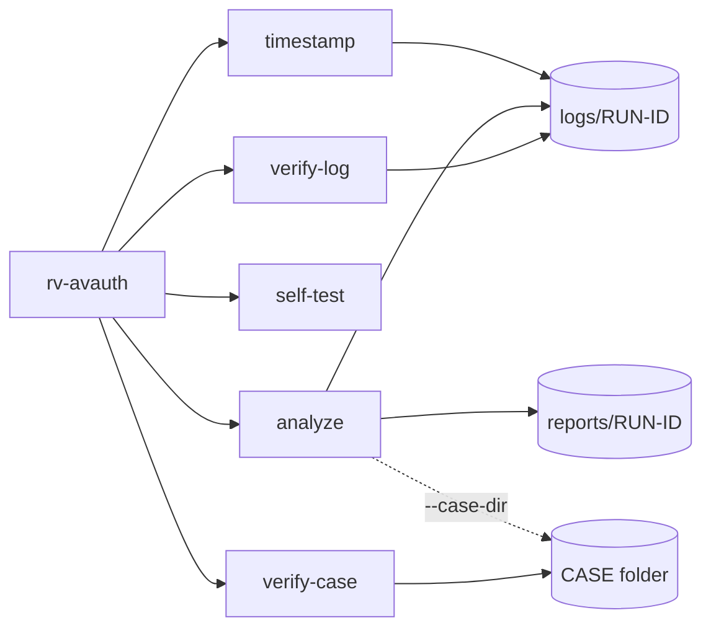

# Command-line reference

<!-- Generated by `rv-avauth docs-cli`. Do not edit by hand: CI fails if this file differs. -->



## rv-avauth

```text
DESCRIPTION:
  rv-avauth looks for signals that an audio or video file was edited, re-encoded or re-wrapped
  after it was recorded. It reviews a single file, a whole folder (bulk) or a list of files. For
  every file it:
    1. opens the file read-only and hashes it in one pass with one or two algorithms;
    2. identifies the container from its content; MP4/MOV/M4A/3GP (ISO BMFF), WAV (RIFF/WAVE,
       RF64), Ogg (Opus, Vorbis) and MP3 files, by content or extension, are examined in an
       isolated worker process (time and memory limits) that re-hashes the bytes it reads and
       compares them with the first pass;
    3. turns what it saw into findings (signals with a severity, what they show and what they do
       not prove) and writes a technical review and a customer summary (HTML, PDF and JSON).
  MEDIA CHECKS (bounded pure-Rust parsers; no size read from the file is trusted):
    - Container vs extension, ISO BMFF brand vs extension, content that is not a container.
    - Structure: box/chunk/tag sizes that do not add up, data after the logical end, truncated
      last box/chunk/page/frame, several mdat boxes, moov after mdat (layout), Ogg CRC-32,
      page sequence and granule continuity, chained Ogg streams, MP3 frame-sync gaps and
      parameter changes, contradictory WAVE format fields.
    - Encoder traces: ilst/udta (©too, ©enc, ©swr), QuickTime keys, hdlr names, stsd vendor and
      compressor, ID3 TSSE/TENC, Xing/Info/LAME tag, Opus/Vorbis vendor and ENCODER, WAVE INFO
      ISFT and bext; classified as editor, online converter, transcoder (FFmpeg/Lavf),
      messenger, encoder library or device, and compared with the device the metadata names.
    - Times: mvhd/tkhd/mdhd creation and modification (1904 epoch, UTC), tag dates, the
      file-system date; durations declared by headers vs computed from samples or frames.
    - Reference comparison (--reference): container, brands, top-level layout, codecs, audio
      parameters, video size, handler names, encoder strings, tag keys, timescales and
      chunk/frame layout against a file known to come from the claimed device or app.
  NOT DONE in this version: ENF (electric network frequency), decoding or listening to the
  content, speaker or deepfake analysis.
  Each run also writes a statistics report and an audit trail under <OUT>/logs/<RUN-ID>/. Every
  action is appended to a hash-chained log that `rv-avauth verify-log` can check later. The
  result is a set of signals for an examiner, never a verdict that a file is authentic or edited.

  CASE FOLDER (--case-dir): Rakvor tools share one folder per case. rv-hashinv, the intake tool,
  registers each evidence file once (evidence ids E0001, E0002, ...). rv-avauth is an analysis
  tool: before analysing a file it re-hashes it and verifies it against that registry, so the
  reports prove the examined file is bit-identical to the registered one. `rv-avauth verify-case
  <CASE>` checks the whole case.

Usage: rv-avauth <COMMAND>

Commands:
  analyze      Look for signals of editing or re-encoding in audio and video files and write the
               reports
  verify-log   Verify an audit log (audit.jsonl): edited, deleted or re-ordered entries, and
               truncation
  self-test    Check every hash algorithm against known-answer test vectors
  timestamp    Add an RFC 3161 timestamp to a finished run (e.g. after working offline)
  verify-case  Verify a whole case folder: case log, evidence registry and every run's audit log
  help         Print this message or the help of the given subcommand(s)

Options:
  -h, --help
          Print help (see a summary with '-h')

  -V, --version
          Print version

Run `rv-avauth <COMMAND> --help` for the options, examples and exit codes of each command.
```

## rv-avauth analyze

```text
DESCRIPTION:
  rv-avauth looks for signals that an audio or video file was edited, re-encoded or re-wrapped
  after it was recorded. It reviews a single file, a whole folder (bulk) or a list of files. For
  every file it:
    1. opens the file read-only and hashes it in one pass with one or two algorithms;
    2. identifies the container from its content; MP4/MOV/M4A/3GP (ISO BMFF), WAV (RIFF/WAVE,
       RF64), Ogg (Opus, Vorbis) and MP3 files, by content or extension, are examined in an
       isolated worker process (time and memory limits) that re-hashes the bytes it reads and
       compares them with the first pass;
    3. turns what it saw into findings (signals with a severity, what they show and what they do
       not prove) and writes a technical review and a customer summary (HTML, PDF and JSON).
  MEDIA CHECKS (bounded pure-Rust parsers; no size read from the file is trusted):
    - Container vs extension, ISO BMFF brand vs extension, content that is not a container.
    - Structure: box/chunk/tag sizes that do not add up, data after the logical end, truncated
      last box/chunk/page/frame, several mdat boxes, moov after mdat (layout), Ogg CRC-32,
      page sequence and granule continuity, chained Ogg streams, MP3 frame-sync gaps and
      parameter changes, contradictory WAVE format fields.
    - Encoder traces: ilst/udta (©too, ©enc, ©swr), QuickTime keys, hdlr names, stsd vendor and
      compressor, ID3 TSSE/TENC, Xing/Info/LAME tag, Opus/Vorbis vendor and ENCODER, WAVE INFO
      ISFT and bext; classified as editor, online converter, transcoder (FFmpeg/Lavf),
      messenger, encoder library or device, and compared with the device the metadata names.
    - Times: mvhd/tkhd/mdhd creation and modification (1904 epoch, UTC), tag dates, the
      file-system date; durations declared by headers vs computed from samples or frames.
    - Reference comparison (--reference): container, brands, top-level layout, codecs, audio
      parameters, video size, handler names, encoder strings, tag keys, timescales and
      chunk/frame layout against a file known to come from the claimed device or app.
  NOT DONE in this version: ENF (electric network frequency), decoding or listening to the
  content, speaker or deepfake analysis.
  Each run also writes a statistics report and an audit trail under <OUT>/logs/<RUN-ID>/. Every
  action is appended to a hash-chained log that `rv-avauth verify-log` can check later. The
  result is a set of signals for an examiner, never a verdict that a file is authentic or edited.

  CASE FOLDER (--case-dir): Rakvor tools share one folder per case. rv-hashinv, the intake tool,
  registers each evidence file once (evidence ids E0001, E0002, ...). rv-avauth is an analysis
  tool: before analysing a file it re-hashes it and verifies it against that registry, so the
  reports prove the examined file is bit-identical to the registered one. `rv-avauth verify-case
  <CASE>` checks the whole case.

Usage: rv-avauth analyze [OPTIONS]

Options:
  -i, --input <PATH>
          File or folder to review. Repeat for several.
          
          Folders are reviewed one level deep unless --recursive is given. Symbolic links are not
          followed.
          Default: none (required unless --input-list, --case-dir or --evidence is given).
          Example: --input D:\evidence --input E:\phone-export\chat.txt

  -L, --input-list <FILE>
          Text file with one path per line (bulk review). Lines starting with # are ignored.
          
          Relative paths are resolved from the list file's folder.
          Default: none. Example: --input-list case-014-files.txt

  -r, --recursive
          Also review files in subfolders.
          
          Default: off (only the first level of each folder). Example: -i D:\evidence --recursive

  -H, --hash <ALGO>
          Hash algorithm(s): one or two of md5, sha1, sha256, sha512, sha3-256, blake3.
          
          Both are computed in the same read of each file. More than two is refused (exit code 2).
          Default: sha256. Example: --hash sha256,md5   or   --hash sha256 --hash blake3

  -o, --out <DIR>
          Folder where logs/ and reports/ are created. Created if missing. Ignored with --case-dir.
          
          Default: ./rakvor-out. Example: --out E:\case-014\rv-avauth

  -l, --lang <LANG>
          Report language: en, es, fr, or all (one HTML and PDF per language). JSON is
          language-neutral.
          
          Default: en. Example: --lang es   or   --lang all

  -a, --actor <NAME>
          Name of the examiner, written in every audit entry and report.
          
          Default: the operating-system user name. Example: --actor "Ana Ruiz"

  -c, --case <ID>
          Case or engagement identifier printed on the reports. With --case-dir it names the case
          when the folder is created, and must match case.json afterwards (it can be left out).
          Default: none. Example: --case CASE-2026-014

  -p, --progress <MODE>
          How progress is shown: bar, jsonl or none.
          
          Default: bar (hidden automatically when stderr is not a terminal).
          Example: --progress jsonl

          Possible values:
          - bar:   Progress bar with elapsed time, throughput and ETA on stderr
          - jsonl: One JSON event per line on stdout (for scripts and other tools)
          - none:  No progress output; only the final summary

  -j, --jurisdiction <CC>
          Chain-of-custody form per item: co (Colombia, Fiscalía style, Spanish) or fr (France,
          scellés, French).
          An English copy is always added. With --case-dir the case's jurisdiction applies.
          Default: co
          Example: --jurisdiction fr

      --tsa-url <URL>
          RFC 3161 time-stamping authority for the audit chain head.
          Default: http://timestamp.digicert.com
          Example: --tsa-url https://freetsa.org/tsr

      --no-timestamp
          Do not request a trusted timestamp (offline labs). Also set by RV_NO_TIMESTAMP=1.
          Default: off (a timestamp is requested)
          Example: --no-timestamp

      --sign-cert <P12>
          Examiner's certificate (.p12/.pfx, RSA) used to sign every PDF report. The password is
          read from
          the environment variable named by --sign-pass-env, or asked for interactively.
          Default: none (PDFs are not signed)
          Example: --sign-cert C:\certs\ana-ruiz.p12

      --sign-pass-env <VAR>
          Environment variable holding the certificate password.
          Default: RV_SIGN_PASSWORD
          Example: --sign-pass-env CERT_PASS

      --reference <FILE>
          Domain option. Reference file known to come from the claimed device or app (same model,
          app version and settings), compared with every media item. Repeat for several. Read-only;
          its SHA-256 is recorded (REFERENCE_CONSISTENT / REFERENCE_DIFFERS).
          Default: none
          Example: --reference ref/IMG_0040.MOV

      --worker-timeout <SECS>
          Seconds a worker process may spend on one file before it is stopped (PARSER_FAILED).
          Default: 120
          Example: --worker-timeout 600

      --worker-memory <MB>
          Memory limit of one worker process in MiB (address space on Linux/macOS, job on Windows).
          Default: 1024
          Example: --worker-memory 2048

      --case-dir <DIR>
          Shared case folder that links the Rakvor tools of one case (see docs/case-folder.md).
          Every item is verified against <DIR>/evidence/registry.json (written by the intake tool,
          rv-hashinv) before it is analysed; outputs go to <DIR>/runs/rv-avauth/<RUN-ID>/ and the
          run is recorded in <DIR>/case-log.jsonl. With no --input, every registered item is
          analysed.
          Default: none (standalone run in --out)
          Example: --case-dir E:\CASE-014

  -E, --evidence <IDS>
          Registered evidence ids to analyse (needs --case-dir), comma-separated or repeated.
          Default: none (the --input files, or every registered item)
          Example: --evidence E0001,E0007

  -h, --help
          Print help (see a summary with '-h')

EXAMPLES:
  Review one recording (SHA-256, English reports):
    rv-avauth analyze --input evidence/voice-note.opus
  Review a folder and its subfolders with SHA-256 + MD5, Spanish reports, for case CASE-2026-014:
    rv-avauth analyze -i D:\evidence -r --hash sha256,md5 --lang es --case CASE-2026-014
  Review the files listed in a text file, reports in the three languages, machine-readable progress:
    rv-avauth analyze --input-list files.txt --lang all --progress jsonl > events.jsonl
  Compare with a file known to come from the claimed phone (same model, app and settings):
    rv-avauth analyze -i IMG_0042.MOV --reference ref/IMG_0040.MOV
  Long recordings on a slow disk: more time and memory per worker:
    rv-avauth analyze -i E:\audio -r --worker-timeout 900 --worker-memory 2048
  Verify the audit log afterwards:
    rv-avauth verify-log rakvor-out/logs/<RUN-ID>/audit.jsonl
  Analyse every item registered in a case folder (after rv-hashinv intake), then verify the case:
    rv-avauth analyze --case-dir E:\CASE-014
    rv-avauth verify-case E:\CASE-014
  Analyse two registered items of the case only:
    rv-avauth analyze --case-dir E:\CASE-014 --evidence E0001,E0002

EXIT CODES:
  0    Completed; no high-severity finding.
  1    Runtime error (input or reference not found, output not writable, case log locked,
       ...). See the audit log.
  2    Usage error (unknown option, more than two hash algorithms, unsupported language).
       With --case-dir: folder of another case or schema, unknown evidence id.
  3    Completed with at least one high-severity finding (a file whose analysis could not
       complete, evidence that changed during the run or differs from the case registry, a
       program under another name), or the case folder fails verification (nothing is
       written to it).
  130  Cancelled with Ctrl+C. Partial reports and the cancellation are written to the audit log.

FILES WRITTEN:
  <OUT>/logs/<RUN-ID>/audit.jsonl          Hash-chained log of every action (one JSON object/line).
  <OUT>/logs/<RUN-ID>/audit.log            The same actions, human-readable.
  <OUT>/logs/<RUN-ID>/hashes.csv           Hash register: index, path, size, digests, status.
  <OUT>/logs/<RUN-ID>/environment.json     Tool and dependency versions, OS, host, user, arguments.
  <OUT>/logs/<RUN-ID>/timestamp-<SEQ>.tsr  RFC 3161 token for the audit chain head (+ .json).
  <OUT>/reports/<RUN-ID>/statistics.json   Run statistics (+ statistics.<LANG>.html and .pdf).
  <ITEM> = <OUT>/reports/<RUN-ID>/items/<NNNNN>-<NAME>:
  <ITEM>/technical.json|.<LANG>.html|.pdf  Technical review (container summary, streams, times,
                                           durations, encoders, tags, anomalies, structure tree,
                                           reference comparison, every file written for the item).
  <ITEM>/summary.json|.<LANG>.html|.pdf    Customer summary.
  <ITEM>/custody.json|.<es|fr|en>.html|.pdf  Chain-of-custody form.
  <ITEM>/structure.json                    Full parsed model: box/chunk/page tree with byte offsets,
                                           streams, times, durations, anomalies (media files).
  <ITEM>/metadata.json                     Every tag, encoder string, device field and time read.
  <ITEM>/reference-comparison.json         With --reference: fingerprints and the comparison table.
  Every file under <ITEM> is hashed with the selected algorithms and recorded in the audit log.
  With --case-dir <CASE>, logs/ and reports/ go to <CASE>/runs/rv-avauth/<RUN-ID>/, and:
  <CASE>/case-log.jsonl                    Hash-chained case log of every tool: run_started and
                                           run_finished of this run are appended to it.
  <CASE>/case.json                         Case id and jurisdiction (only if the folder is new).
  The evidence registry (<CASE>/evidence/registry.json) is read, never written, by rv-avauth.

FORENSIC NOTES:
  - Evidence is opened read-only and never modified; modification times are compared before and
    after. Work on a verified copy (write-blocked image or export), not on original media.
  - Findings are signals, not a verdict: a file without findings is not proven authentic, and a
    finding does not prove editing. Read "What it does not prove" and the Limitations section.
  - Media files are analysed in a separate worker process with a time and memory limit; every
    read of the parsers is bounded by the real file length and fixed caps, so a hostile file
    costs one item (PARSER_FAILED), never the run or the audit log.
  - Tags, encoder strings, device names and internal times are written by software and can be
    forged or removed; re-encoding or a messenger destroys most traces. No ENF, content or
    speaker analysis is done.
  - Each audit entry stores the SHA-256 of the previous one; editing, deleting or re-ordering any
    line is detected by `verify-log`. Removing the last lines is detected only against a record
    kept outside the log: the RFC 3161 timestamp or, with --case-dir, the case log. Keep the log
    folder with the reports.
  - MD5 and SHA-1 are accepted for compatibility with older case files; pair them with SHA-256 or
    BLAKE3.
  - The chain head is timestamped by an RFC 3161 authority (proves when the log existed).
    Offline? The run finishes with `timestamp_pending`; run `rv-avauth timestamp <LOG>` later.
  - With --sign-cert every PDF is signed with the examiner's certificate; the password is never
    logged.
  - Case folder: every item is compared with the registry (by --evidence id, else by path, else
    by content) before it is analysed; a different hash is the high finding
    EVIDENCE_HASH_MISMATCH_WITH_CASE (the analysis still runs), a file not in the registry is
    EVIDENCE_NOT_IN_CASE_REGISTRY (medium). The case log and registry digest are re-verified
    before every write; a broken case is refused (exit 3). Appends happen under
    case-log.lock; a lock older than 10 minutes is reported as stale and never deleted
    automatically.
  - Each run's audit.jsonl records case_linked (the case-log entry it started from); the case
    log records the run's final audit head, so the two chains vouch for each other.
```

## rv-avauth verify-log

```text
Verify an audit log (audit.jsonl): edited, deleted or re-ordered entries, and truncation

Usage: rv-avauth verify-log [OPTIONS] <LOG>

Arguments:
  <LOG>
          Path to audit.jsonl, or to the run's log folder that contains it.
          
          Example: rakvor-out/logs/20261019T101500Z-a1b2c3

Options:
      --tsa-ca <PEM>
          CA bundle (PEM with one or more certificates, or one DER certificate) that the TSA
          certificate of every timestamp token must chain to, at the token's genTime.
          
          Default: none (the TSA signature is checked, the chain is not).
          Example: --tsa-ca C:\certs\tsa-roots.pem

  -h, --help
          Print help (see a summary with '-h')

CHECKS:
  - every entry links to the previous one (hash chain): an edited, deleted or re-ordered entry
    breaks it;
  - every timestamp token the log records (timestamp_obtained) is still next to it with its
    metadata (timestamp-<SEQ>.tsr with the recorded SHA-256, timestamp-<SEQ>.json agreeing): a
    missing file is a problem, never a skipped check; a token file no entry records is checked
    too. Every token covers the hash of the entry it names;
  - the TSA's CMS signature of every token: signer certificate in the token, ESS
    signing-certificate binding, message digest over TSTInfo, RSA signature, and an extended key
    usage that is critical and only timeStamping (RFC 3161). With --tsa-ca, also the TSA
    certificate path up to that CA bundle at the token's genTime (every candidate issuer tried;
    CA flag, keyCertSign, pathLenConstraint, directoryName name constraints, no unsupported
    critical extension); without it the output says "chain not checked". Revocation is
    never checked: establish it from CRL/OCSP evidence covering genTime;
  - truncation: a chain alone cannot show that entries were removed from its end. The log must
    still contain the entry covered by its RFC 3161 timestamp (covers_seq) and, for a run inside
    a case folder (<CASE>/runs/<TOOL>/<RUN-ID>/logs), end with the audit head that the case log
    recorded at run_finished (only timestamp_obtained may follow). Entries after the last
    anchored one are listed as not provable; with neither record the output says
    "truncation not detectable without a timestamp or case record";
  - recorded outputs: every file the log says the run wrote (item reports, statistics,
    hashes.csv, environment.json) is re-hashed with each algorithm recorded and compared; the
    latest entry for a file wins. A missing, edited or replaced file is a problem; a recorded
    path that is absolute, contains .. or resolves outside the run folder (symlink, junction)
    is rejected and not read. Timestamp tokens (checked above) and files written outside the
    run folder are listed as not re-hashed, with the reason. Output: "outputs: N verified of
    M recorded (algorithms)".

EXAMPLES:
  rv-avauth verify-log rakvor-out/logs/20261019T101500Z-a1b2c3/audit.jsonl
  rv-avauth verify-log rakvor-out/logs/20261019T101500Z-a1b2c3
  rv-avauth verify-log E:\CASE-014\runs\rv-avauth\20261019T101500Z-a1b2c3\logs
  rv-avauth verify-log rakvor-out/logs/20261019T101500Z-a1b2c3 --tsa-ca digicert-tsa-roots.pem

EXIT CODES:
  0  The chain is intact and agrees with its timestamps and case record (if any), and every
     output file it records (reports, hashes.csv, environment.json) still has the recorded
     digests.
  1  The log or the --tsa-ca file cannot be read.
  3  The chain is broken (an entry was edited, deleted or re-ordered), a timestamp does not
     match or does not verify (altered token, invalid TSA signature, chain not trusted by
     --tsa-ca), the log is shorter than its timestamp or case record says (truncated), or
     a recorded output file was edited, deleted or replaced after the run (named in the
     output; a recorded path that leads outside the run folder is rejected, not read).
```

## rv-avauth self-test

```text
Check every hash algorithm against known-answer test vectors

Usage: rv-avauth self-test

Options:
  -h, --help
          Print help (see a summary with '-h')

EXAMPLES:
  rv-avauth self-test

EXIT CODES:
  0  All algorithms give the published answer for the input "abc".
  1  At least one algorithm failed: do not use this build for evidence.
```

## rv-avauth timestamp

```text
Add an RFC 3161 timestamp to a finished run (e.g. after working offline)

Usage: rv-avauth timestamp [OPTIONS] <LOG>

Arguments:
  <LOG>
          The run's log folder (or its audit.jsonl).
          
          Example: rakvor-out/logs/20261019T101500Z-a1b2c3

Options:
      --tsa-url <URL>
          RFC 3161 time-stamping authority.
          Default: http://timestamp.digicert.com
          Example: --tsa-url https://freetsa.org/tsr

  -a, --actor <NAME>
          Name written in the new audit entry.
          Default: the operating-system user name
          Example: --actor "Ana Ruiz"

  -h, --help
          Print help (see a summary with '-h')

EXAMPLES:
  rv-avauth timestamp rakvor-out/logs/20261019T101500Z-a1b2c3
  rv-avauth timestamp rakvor-out/logs/20261019T101500Z-a1b2c3 --tsa-url https://freetsa.org/tsr

EXIT CODES:
  0  Timestamp obtained and logged.
  1  The TSA could not be reached (nothing changed; try again).
  3  The log is missing or broken: no timestamp is added.
```

## rv-avauth verify-case

```text
Verify a whole case folder: case log, evidence registry and every run's audit log

Usage: rv-avauth verify-case [OPTIONS] <CASE>

Arguments:
  <CASE>
          The case folder (the one that holds case.json).
          
          Example: E:\CASE-014

Options:
      --rehash
          Also re-hash every registered item still reachable and compare it with the registry.
          Default: off (only the registry's digest is checked)
          Example: --rehash

  -h, --help
          Print help (see a summary with '-h')

CHECKS:
  - case-log.jsonl is an intact hash chain starting with case_created; case.json is unchanged;
  - evidence/registry.json has the SHA-256 recorded at the last registry change;
  - every run announced in the case log has an intact audit.jsonl (and valid timestamp
    tokens: imprint and TSA signature; the TSA chain is not checked, use verify-log
    --tsa-ca), its case_linked entry points to its run_started entry, and the audit head
    recorded at run_finished is its final entry (only timestamp_obtained may follow);
  - every output file a run's audit log records (reports, hashes.csv, environment.json) is
    re-hashed and compared with the recorded digests (edited, deleted or replaced: a problem);
  - with --rehash: every registered item still reachable at its registered path is read again
    and its digests are compared with the registry (the latest registration of a path).

EXAMPLES:
  rv-avauth verify-case E:\CASE-014
  rv-avauth verify-case E:\CASE-014 --rehash

EXIT CODES:
  0  The case folder is intact (warnings, e.g. a run still in progress or an item not
     reachable for --rehash, are printed).
  1  The folder is not a case folder (no case.json).
  3  At least one check failed: the case was edited, truncated or re-ordered, a run's
     recorded output (report, register) was edited, deleted or replaced, or (--rehash) an
     evidence file differs from the registry.
```

## rv-avauth describe

```text
Describe this tool as JSON (schema rakvor.describe/1) for RV Hub and scripts

Usage: rv-avauth describe [OPTIONS]

Options:
      --json
          Print JSON: one pretty-printed object with sorted keys.
          Default: on (JSON is the only format)
          Example: --json

  -h, --help
          Print help (see a summary with '-h')

DESCRIPTION:
  Prints what this tool is, what it accepts and how to launch it, validated by
  schemas/describe.schema.json. RV Hub reads it to list the tool, start its GUI on a case
  folder (rv-avauth-gui.exe --case-dir <CASE> [FILES...]) and suggest the tool for a file.
  Fields: schema, tool, title, version, role (analysis), main_verb (analyze), accepts
  (extensions and signatures; "*" = any file), case_formats, log_formats, cli_exe,
  gui_exe, exit_codes. Nothing is read or written; no audit log is created.

EXAMPLES:
  rv-avauth describe --json

EXIT CODES:
  0  The description was printed.
```

