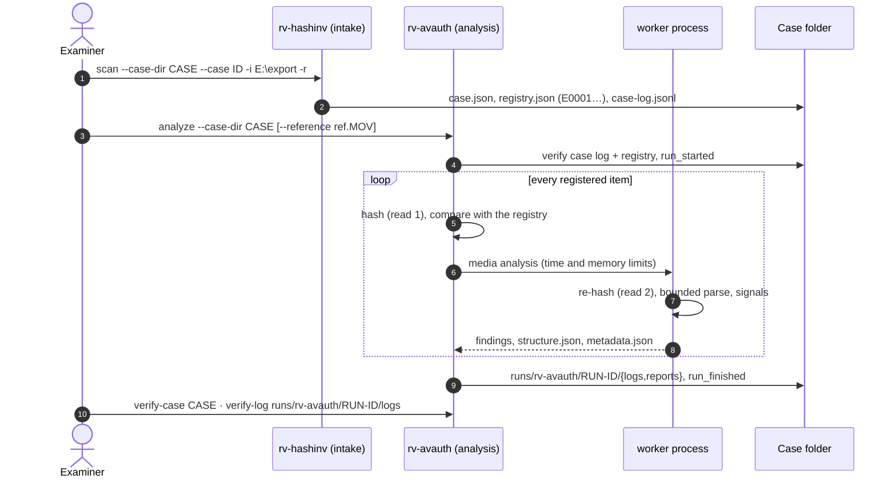

# Using RV AvAuth on a case

This page walks through one engagement end to end: register the evidence with the intake tool, analyse the audio
and video files with RV AvAuth, read the outputs, verify everything, and decide what to check next. Command
details are in [usage-cli.md](usage-cli.md) (generated from the binary); the window is described in
[usage-gui.md](usage-gui.md); what each check means is in [theory.md](theory.md).



## 1. Before you start

- Work on a **verified copy** (write-blocked image or export), never on the original medium. RV AvAuth opens files
  read-only and compares their modification times before and after, but it cannot protect a medium that another
  program writes to.
- Run `rv-avauth self-test` once per workstation and release (known-answer test of every hash algorithm).
- If a device or app is claimed (for example "recorded with the phone's camera app"), obtain a **reference file**
  from the same model, app version and recording settings, made by you or with documented provenance. Keep it with
  the case notes: its SHA-256 is recorded in every report that used it.

## 2. Intake: register the evidence

The intake tool (rv-hashinv) creates the case folder and gives each file an evidence id. RV AvAuth never writes the
registry.

```powershell
rv-hashinv scan --case-dir D:\cases\CASE-2026-014 --case CASE-2026-014 --jurisdiction co `
    -i E:\export -r --hash sha256,md5
```

Without a case folder, RV AvAuth also works alone with `--out DIR` (no registry comparison).

## 3. Analyse

```powershell
# Every registered item, Spanish and English reports, with a reference from the claimed phone
rv-avauth analyze --case-dir D:\cases\CASE-2026-014 --lang es,en --reference D:\refs\IMG_0040.MOV

# Some items only
rv-avauth analyze --case-dir D:\cases\CASE-2026-014 --evidence E0003,E0007

# Standalone, a folder, machine-readable progress
rv-avauth analyze -i E:\audio -r --out D:\work\avauth --progress jsonl > events.jsonl

# Long recordings on slow storage: more time and memory per worker
rv-avauth analyze -i E:\video -r --worker-timeout 900 --worker-memory 2048
```

In the GUI: add the files or set **Case folder**, choose the hash algorithms and report language, optionally set
**5. Media analysis → Reference file**, press **Start review**, then **Open report**.

The summary line shows the run id, the counts by severity and where the reports and logs are. Exit code 0 means no
high finding; 3 means at least one (for example a file whose analysis could not complete, or one that differs from
the registry).

## 4. Read the outputs

| File | Read it for |
| --- | --- |
| `reports/<RUN-ID>/statistics.<lang>.html` | The run: items, findings by severity and code, items by container, duplicates, case verification, timestamp |
| `items/<NNNNN>-<name>/technical.<lang>.html` / `.pdf` | One file in depth: hashes, findings (shows / does not prove), media analysis (container overview, streams, times, durations, encoders, device claim, tags, anomalies, structure tree, reference table), files written, audit entries, limitations |
| `items/…/summary.<lang>.html` | The same file in plain language for the client |
| `items/…/custody.<es|fr|en>.html` | Chain-of-custody form (Colombia or France, plus English) |
| `items/…/structure.json` | The complete parsed model, with byte offsets (open next to a hex viewer) |
| `items/…/metadata.json` | Every tag, encoder string, device field and time read |
| `items/…/reference-comparison.json` | Both fingerprints and the aspect-by-aspect comparison (`--reference`) |
| `logs/<RUN-ID>/audit.jsonl` | Every action, hash-chained; `hashes.csv` is the hash register |

## 5. From a finding to the next check

| Finding | Next check | Do not conclude |
| --- | --- | --- |
| `EDITING_SOFTWARE_TRACE`, `ONLINE_CONVERTER_TRACE` | Ask how the file was obtained; look for the first-generation file on the device; compare with a reference | That the content was edited |
| `TRANSCODER_TRACE` (FFmpeg/Lavf) | Which app or service handed over the file (many embed FFmpeg) | That someone used FFmpeg on purpose |
| `ENCODER_CONFLICTS_WITH_DEVICE_CLAIM` | Obtain the original from the device; compare with a reference from the claimed device | That the device claim is false |
| `MEDIA_TIMES_INCONSISTENT`, `MEDIA_MODIFIED_AFTER_CREATION`, `TAG_TIME_DIFFERS_FROM_HEADER` | Device clock and time zone; the software that last saved the file | Which date is the true one |
| `DURATION_MISMATCH`, `TRUNCATED_STREAM` | Whether the recording or the copy was interrupted; play the end of the file | Where content was removed |
| `TRAILING_DATA` | Carve and examine the extra bytes (offset in the finding and `structure.json`) | What the bytes are or who added them |
| `FRAME_SYNC_GAPS`, `STREAM_PARAMETERS_CHANGE`, `OGG_*` | Listen around the offsets; examine with a second tool | That two recordings were spliced |
| `REFERENCE_DIFFERS` | That the reference really matches model, app version and settings | That the evidence is not from the device |
| `PARSER_FAILED` | Re-run with higher `--worker-timeout` / `--worker-memory`; examine manually | That the file is malicious or manipulated |
| `EVIDENCE_HASH_MISMATCH_WITH_CASE` | Which copy was registered; storage integrity | Who changed the file |

No finding at all is **not** proof of authenticity: read the limitations printed on every report (no ENF, no
content or speaker analysis, metadata can be forged or stripped, limited container coverage).

## 6. Verify

```powershell
rv-avauth verify-log D:\cases\CASE-2026-014\runs\rv-avauth\<RUN-ID>\logs        # chain, timestamps, outputs
rv-avauth verify-case D:\cases\CASE-2026-014 --rehash                            # whole case, re-hash evidence
python tests\verify_chain.py D:\cases\CASE-2026-014\runs\rv-avauth\<RUN-ID>\logs   # independent verifier
```

## 7. Troubleshooting

| Exit code / symptom | Meaning | What to do |
| --- | --- | --- |
| 1 | Input or reference file not found, output not writable, case log locked, wrong certificate password | Read the error line and the audit log |
| 2 | Usage error (unknown option, three hash algorithms, unknown language, wrong case id or evidence id) | `rv-avauth analyze --help` |
| 3 | Done with a high finding, or a broken case folder (nothing written) | Open the statistics report; for a broken case run `verify-case` |
| 130 | Cancelled with Ctrl+C | Partial reports and `run_cancelled` are in the log |
| `PARSER_FAILED` reason `timeout` | The worker hit `--worker-timeout` | Raise the limit; very long MP3/Ogg files are walked frame by frame |
| `PARSER_FAILED` reason `memory_limit` | The worker hit `--worker-memory` | Raise the limit |
| `timestamp: pending` | The TSA was unreachable | `rv-avauth timestamp <LOG>` later |
| A second `rv-avauth.exe` process during a run | The isolated media worker | Expected |
