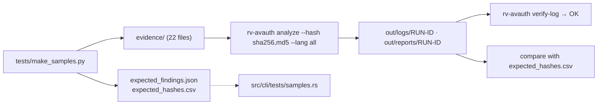

# Examples

## `sample/` — 22 synthetic files that exercise every media check

Every file is **synthetic**, generated byte by byte by [tests/make_samples.py](../tests/make_samples.py) (Python
standard library only, deterministic): a 440 Hz tone or filler bytes, no recording, no voice, no person. Software
names inside them are plain strings (see [NOTICE](../NOTICE)). The script also writes
`expected_findings.json` (the ground truth the end-to-end test checks) and `expected_hashes.csv` (all six
algorithms, computed with Python `hashlib` and `blake3`, independently of the tool).

| File | What it demonstrates | Expected findings |
| --- | --- | --- |
| `evidence/bad-fmt.wav` | WAVE whose byte rate contradicts sample rate × block align | FORMAT_PARAMETERS_INCONSISTENT, METADATA_ABSENT |
| `evidence/broken-box.mp4` | `tkhd` size field 200 bytes past its `trak` | METADATA_ABSENT, STRUCTURE_SIZE_INCONSISTENT |
| `evidence/camera-edited.mov` | QuickTime file: track created 1 day after the movie, modified 3 days later, date tag 10 days earlier, `©too` Adobe Premiere next to device keys | DEVICE_CLAIM, EDITING_SOFTWARE_TRACE, ENCODER_CONFLICTS_WITH_DEVICE_CLAIM, ENCODER_IDENTIFIED, MEDIA_MODIFIED_AFTER_CREATION, MEDIA_TIMES_INCONSISTENT, MOOV_AFTER_MDAT, TAG_TIME_DIFFERS_FROM_HEADER, VENDOR_TRACES |
| `evidence/camera-original.mov` | QuickTime file as a phone camera app writes it (keys make/model/software, Core Media handler, moov after mdat) | DEVICE_CLAIM, ENCODER_IDENTIFIED, MOOV_AFTER_MDAT, VENDOR_TRACES |
| `evidence/camera-renamed.mp4` | The same structure under an `.mp4` name | BRAND_EXTENSION_MISMATCH, DEVICE_CLAIM, ENCODER_IDENTIFIED, MOOV_AFTER_MDAT, VENDOR_TRACES |
| `evidence/chained.ogg` | Two Vorbis streams one after the other | ENCODER_IDENTIFIED, OGG_CHAINED_STREAMS |
| `evidence/duration-mismatch.mp4` | `mdhd` says 10 s, the sample table 0.5 s; two `mdat` boxes | DURATION_MISMATCH, METADATA_ABSENT, MULTIPLE_MDAT |
| `evidence/empty.wav` | 0 bytes under a media name | EMPTY_FILE, MEDIA_NOT_RECOGNISED |
| `evidence/memo-converted.mp3` | ID3v2.4 TSSE Lavf, TENC online converter, Xing header claims 40 frames for 20 | DURATION_MISMATCH, ENCODER_IDENTIFIED, ONLINE_CONVERTER_TRACE, TRANSCODER_TRACE |
| `evidence/memo-lame.mp3` | Ordinary LAME-encoded CBR MP3 with Info tag | ENCODER_IDENTIFIED |
| `evidence/memo-spliced.mp3` | MPEG-1 44.1 kHz frames, 300 junk bytes, then MPEG-2 22.05 kHz frames | FRAME_SYNC_GAPS, METADATA_ABSENT, STREAM_PARAMETERS_CHANGE |
| `evidence/memo-truncated.mp3` | Last frame cut | METADATA_ABSENT, TRUNCATED_STREAM |
| `evidence/notes.txt` | Not a media file: inventory checks only | — |
| `evidence/renamed-wave.mp3` | WAVE content under an `.mp3` name | CONTAINER_EXTENSION_MISMATCH, METADATA_ABSENT |
| `evidence/tone-appended.wav` | 2 048 non-zero bytes after the RIFF form | METADATA_ABSENT, TRAILING_DATA |
| `evidence/tone-edited-audacity.wav` | Recorder `bext` originator plus INFO ISFT Audacity | DEVICE_CLAIM, EDITING_SOFTWARE_TRACE, ENCODER_CONFLICTS_WITH_DEVICE_CLAIM, ENCODER_IDENTIFIED |
| `evidence/tone-original.wav` | 440 Hz tone with a recorder `bext` and INFO date | DEVICE_CLAIM, ENCODER_IDENTIFIED |
| `evidence/tone-truncated.wav` | `data` and RIFF sizes claim twice the bytes present | DURATION_MISMATCH, METADATA_ABSENT, TRUNCATED_STREAM |
| `evidence/voice-note-spliced.opus` | Opus pages with a sequence gap, a granule going back, a bad CRC; Lavf vendor | ENCODER_IDENTIFIED, OGG_CRC_MISMATCH, OGG_GRANULE_NOT_MONOTONIC, OGG_PAGE_SEQUENCE_GAP, TRANSCODER_TRACE |
| `evidence/voice-note-truncated.opus` | Last page cut, no end-of-stream | ENCODER_IDENTIFIED, TRUNCATED_STREAM |
| `evidence/voice-note.opus` | Ordinary Opus stream (libopus vendor) | ENCODER_IDENTIFIED |
| `evidence/voice-reencoded.m4a` | MP4 written by FFmpeg (Lavf `©too`, SoundHandler, times zero, moov first) | ENCODER_IDENTIFIED, MEDIA_TIMES_ZERO, TRANSCODER_TRACE |

`reference/camera-reference.mov` is a second "camera app" file (other times, same structure) for `--reference`:
`camera-original.mov` gives `REFERENCE_CONSISTENT`, `voice-reencoded.m4a` gives `REFERENCE_DIFFERS`.



Run it:

```bash
examples/sample/run.sh target/release/rv-avauth          # Linux / macOS
```

```powershell
.\examples\sample\run.ps1 -Bin .\rv-avauth.exe          # Windows
```

Expected summary: 22 items, 0 errors, findings `high 0, medium 21, low 11, info 33`, exit code 0.

With the reference:

```bash
rv-avauth analyze -i examples/sample/evidence --reference examples/sample/reference/camera-reference.mov
```

Regenerate the samples (after changing the generator, then update the tests):

```bash
python tests/make_samples.py
```
